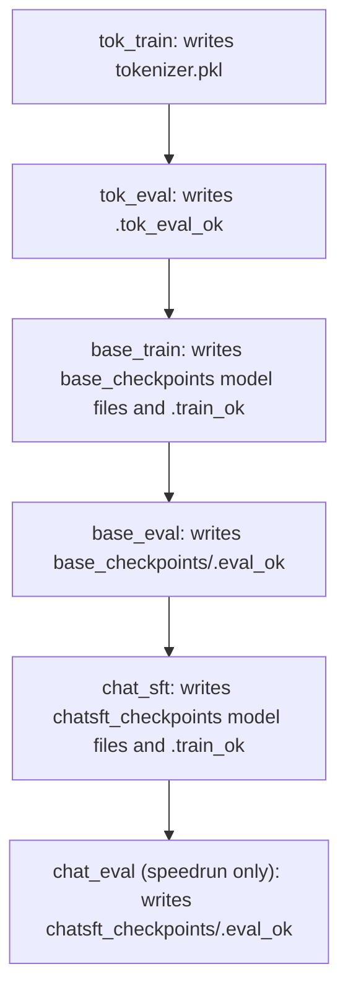
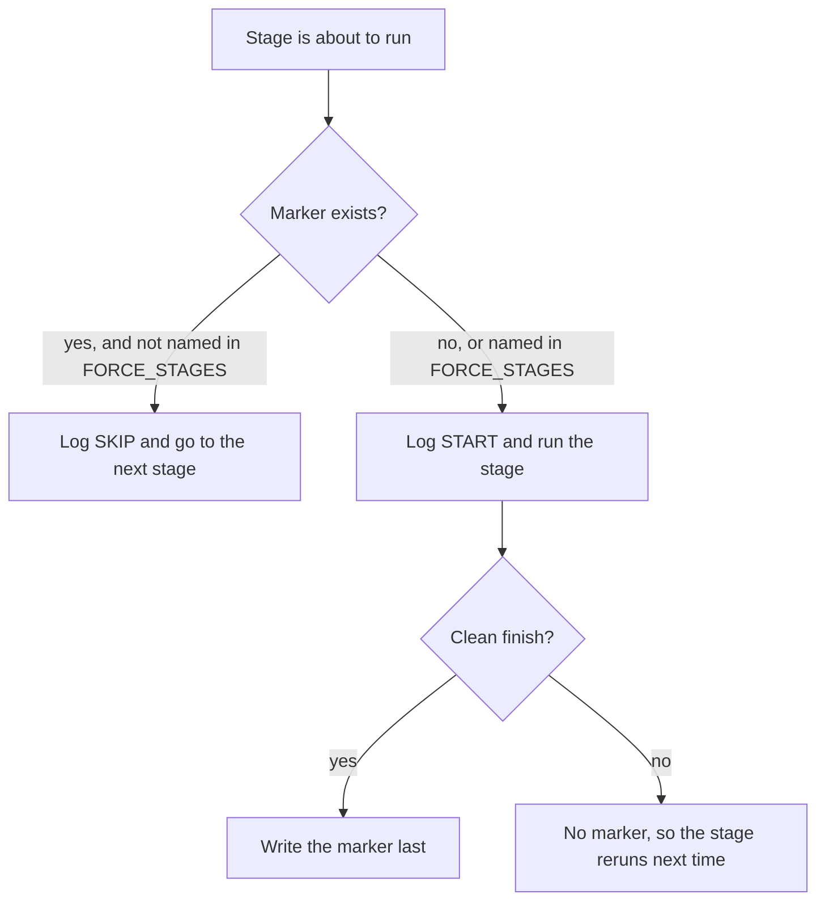

# Diagrams

Every diagram for this project lives in this file. Other docs link here, so there is one place to update when the pipeline changes.

| Diagram | What it answers | Linked from |
|---|---|---|
| [Training pipeline](#training-pipeline) | Which stages run, in what order, and what each one writes | [RUNNING.md](RUNNING.md) §4, [MODAL.md](MODAL.md), [README](../README.md) |
| [Skip decision](#skip-decision) | Why a stage prints `SKIP`, `FORCE`, or `START` | [RUNNING.md](RUNNING.md) §4 |
| [Modal data flow and commit handshake](MODAL.md#how-the-pieces-fit) | Where data lives on the laptop and the Volume, and why a stage waits after it finishes | [MODAL.md](MODAL.md) |
| Checkpoint and resume | Planned. When a checkpoint counts as complete, what a resume restores, and when it refuses | Not yet written |

## Training pipeline

The four core stages run in this order. Chat evaluation (`chat_eval`) runs only in the GPU speedrun. Each stage writes its outputs under `$NANOCHAT_BASE_DIR`, and its marker file is the last thing it writes.

On Modal the same stages run, but the base directory is `/data/nanochat-modal/<mode>/` on the Volume, so CPU and GPU runs keep separate folders.

## Skip decision

Before each stage, the runner checks its marker. This is the rule behind the `SKIP`, `FORCE`, and `START` log lines in [RUNNING.md](RUNNING.md) §5.

A stray `model_*.pt` from a probe or an interrupted run does not count as finished. Only the marker does.
