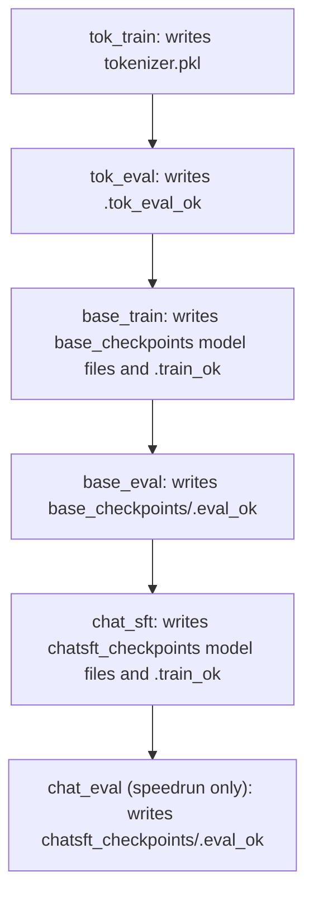
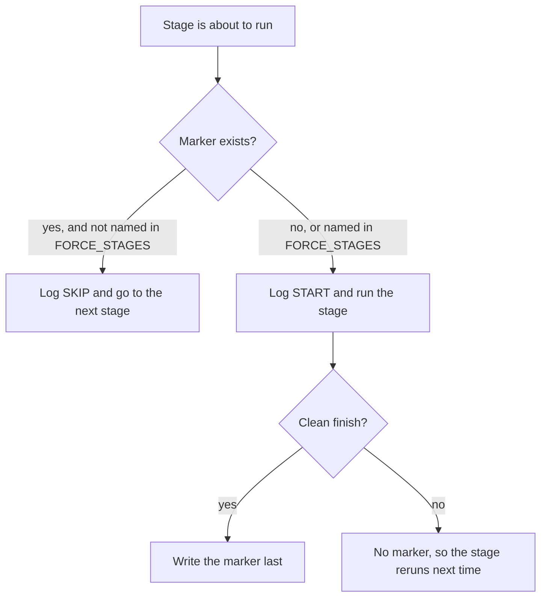
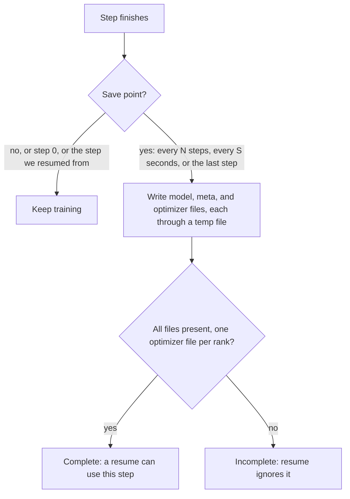
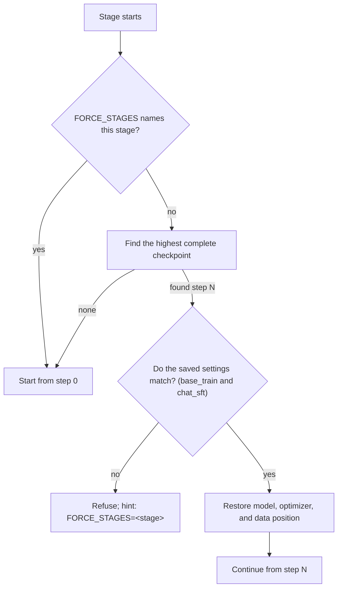

# Diagrams

Every diagram for this project lives in this file. Other docs link here, so there is one place to update when the pipeline changes.

| Diagram | What it answers | Linked from |
|---|---|---|
| [Training pipeline](#training-pipeline) | Which stages run, in what order, and what each one writes | [RUNNING.md](RUNNING.md) §4, [MODAL.md](MODAL.md), [README](../README.md) |
| [Skip decision](#skip-decision) | Why a stage prints `SKIP`, `FORCE`, or `START` | [RUNNING.md](RUNNING.md) §4 |
| [Modal data flow and commit handshake](MODAL.md#how-the-pieces-fit) | Where data lives on the laptop and the Volume, and why a stage waits after it finishes | [MODAL.md](MODAL.md) |
| [Checkpoint and resume](#checkpoint-and-resume) | When a checkpoint counts as complete, what a resume restores, and when it refuses | [RUNNING.md](RUNNING.md) §4, [MODAL.md](MODAL.md) |

## Training pipeline

The four core stages run in this order. Chat evaluation (`chat_eval`) runs only in the GPU speedrun. Each stage writes its outputs under `$NANOCHAT_BASE_DIR`, and its marker file is the last thing it writes.

On Modal the same stages run, but the base directory is `/data/nanochat-modal/<mode>/` on the Volume, so CPU and GPU runs keep separate folders.

## Skip decision

Before each stage, the runner checks its marker. This is the rule behind the `SKIP`, `FORCE`, and `START` log lines in [RUNNING.md](RUNNING.md) §5.

A stray `model_*.pt` from a probe or an interrupted run does not count as finished. Only the marker does.

## Checkpoint and resume

A checkpoint is a set of files written during a long stage. It is not a stage marker. Two stages save checkpoints:

- **base_train:** `base_checkpoints/<model-tag>/`
- **chat_sft:** `chatsft_checkpoints/<model-tag>/`

For `runs/runcpu.sh` the model tag is the run id (one folder per run, e.g. `…-cpu-d6`). For `runs/speedrun.sh` it is the shared `d<depth>` folder.

### When a checkpoint is saved, and when it counts

### What a resume does

### The two stages side by side

| | base_train | chat_sft |
|---|---|---|
| Who picks the resume step | The runner's probe passes `--resume-from-step` | The script auto-detects it |
| Config check before resume | Refuses if `device_batch_size`, `max_seq_len`, `total_batch_size`, `num_iterations`, or `world_size` changed (`assert_resume_config_matches`, shared key list in `nanochat/checkpoint_manager.py`) | Same check; same shared key list |
| Restores | Model, optimizer, data position | Model, optimizer, data position, loop state |
| Local status | Kill and SIGTERM verified on CPU/MPS (Step A) | Implemented; not verified end to end |
| Modal status | PARTIAL: manual stop+resume verified 2026-11-17 on run `20261117-181526-cpu-d6` — log showed `Resuming optimization from step 39`. True Modal-initiated preemption (container suspended by scheduler) not yet verified. | Not verified |

Known gaps:

- **DDP data position:** rank 0 is restored exactly. Ranks 1 and up snap to the nearest stride, so they may re-read or skip a few samples (see [RUNNING.md](RUNNING.md) §4).
- **Stage markers** are separate from checkpoints and are profile+depth-scoped (e.g. `.stage_base_train_runcpu_d6`), stored in the run's own folder for runcpu. A marker mismatch causes the stage to rerun.
