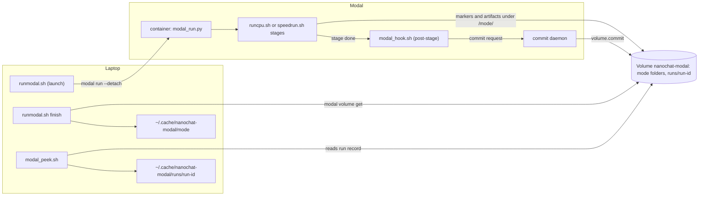
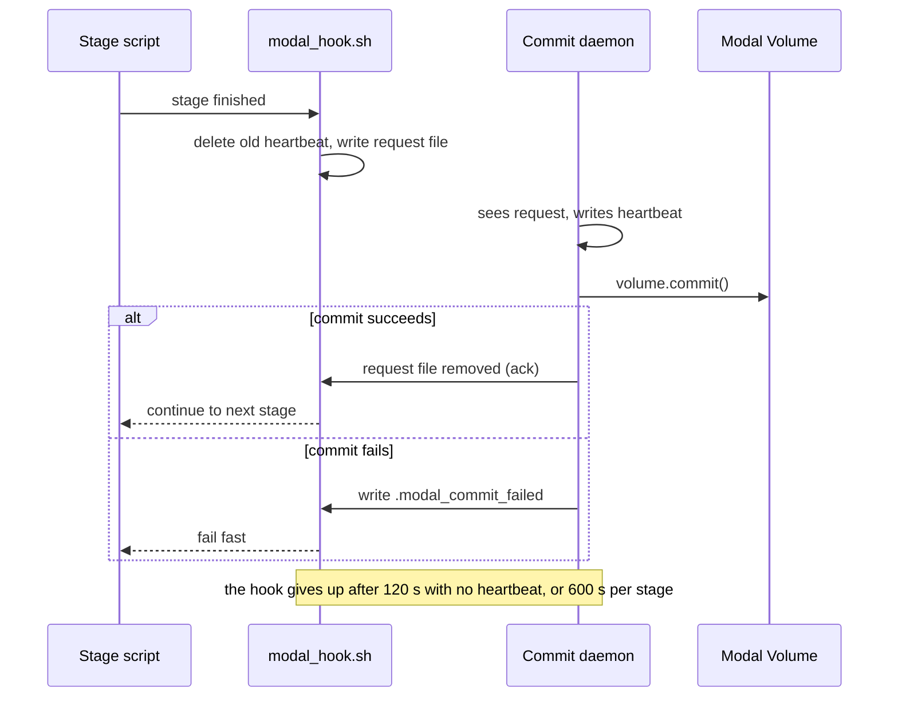

# Training on Modal (Cloud CPU or GPU)

Train a small LLM on Modal (`MODE=cpu`, the default) or a GPT-2-grade LLM on Modal's 8×H100 GPU cluster (`MODE=gpu`). This guide covers the quickest path from zero to a working chat model.

| Mode | Runs | Machine | Needs |
|------|------|---------|-------|
| `cpu` (default) | `runs/runcpu.sh` (small profile, depth 6) | Up to 64 cores / 128 GiB, no GPU | Modal account, `modal` CLI |
| `gpu` | `runs/speedrun.sh` (GPT-2-grade, depth 24) | 8×H100 | The above, plus an 8×H100 entitlement and a Modal payment method |

## Prerequisites

You need these **once per account**:

1. **Modal account** — sign up at [modal.com](https://modal.com)
2. **8×H100 entitlement** (GPU mode only) — Modal needs to grant this (request in the dashboard or contact support; new accounts may default to smaller GPU pools)
3. **Local `modal` CLI** — install with `pip install modal` or `uv tool install modal`, then run `modal setup` (this authenticates your CLI to your Modal account)

You do not need a local GPU to run training on Modal, but you do need enough local disk and RAM to download the trained model afterward (see [Chat locally](#chat-locally) below).

## Runtime config and environment

### Your machine (where you run `runmodal.sh`)

- **Python 3.11 or newer** for the local `modal` CLI. Modal's CLI printed this during our pytest run: `Python 3.10 is EOL and Modal will not support it in version 1.7.0`.
- `**bash`, `git`, and the `modal` CLI** on `PATH`. The script stops if `modal` is missing.
- **Network access** during the run. Runs are detached by default, so the job keeps going if this terminal disconnects. `ATTACHED=1` streams output here instead; then keep the laptop awake and use `screen` or `tmux`.
- **Disk:** room under `~/.cache/nanochat-modal/<mode>` for the downloaded tokenizer and chat checkpoint.

You do not need a local GPU or the training dependencies. Modal builds them into its own image. For the local install paths and the torch build per platform, see the README [Setup](../README.md#setup) section; for dtype per device, see [Precision / dtype](../README.md#precision--dtype).

### Modal side

| | CPU mode (`MODE=cpu`) | GPU mode (`MODE=gpu`) |
|---|---|---|
| Machine | 64 cores, 128 GiB RAM, no GPU | 8×H100 |
| Entry script in container | `runs/runcpu.sh` | `runs/speedrun.sh` |
| Python dependency group | `cpu` extra | `gpu` extra |
| Account needs | Nothing extra | GPU entitlement on the account |
| Train timeout | 12 h (billed by actual run time) | 4 h |
| Prefetched data shards | 8 | 170 |

The container sets `SKIP_SETUP=1`, so it uses the prebuilt `.venv` and does not reinstall. It also sets `NANOCHAT_BASE_DIR=/data/nanochat-modal/<mode>` and `HF_HOME` (inside that folder) on the shared Volume, and runs `runs/modal_hook.sh` after each stage.

### Hyperparameters

The values below are what the scripts actually use. Profile values live in [`nanochat/defaults.py`](../nanochat/defaults.py) (`PROFILE_RUNCPU`, `PROFILE_SPEEDRUN`), and `runs/profiles.sh` is generated from it. Do not hand-edit `profiles.sh`. Modal-only overrides live at the top of [`runs/modal_run.py`](../runs/modal_run.py).

**Tokenizer (both modes):** vocabulary 32768 (2^15), trained on about 2 billion characters.

**CPU mode (`runcpu.sh`, base model and SFT):**

| Setting | Value | Source |
|---|---|---|
| Depth / head dim / window | 6 / 64 / `L` | `PROFILE_RUNCPU` |
| Max sequence length | 512 | `PROFILE_RUNCPU` |
| Total batch size (tokens) | 16384 | `PROFILE_RUNCPU` |
| Device batch size, train | 32 on Modal; 8 locally | `modal_run.py`; `PROFILE_RUNCPU` |
| Device batch size, eval | 16 on Modal; 1 locally | `modal_run.py`; `PROFILE_RUNCPU` |
| Iterations, base | 5000 | `PROFILE_RUNCPU` (Modal sets the same value) |
| Eval every / eval tokens | 100 steps / 524288 | `PROFILE_RUNCPU` |
| SFT iterations / eval every | 1500 / 200 | hardcoded in `runcpu.sh` |

**GPU mode (`speedrun.sh`):**

| Setting | Value | Source |
|---|---|---|
| Depth | 24 | `PROFILE_SPEEDRUN` |
| Device batch size, train / eval | 16 / 16 | `PROFILE_SPEEDRUN` |
| Target param-to-data ratio | 8 | `PROFILE_SPEEDRUN` |
| Max sequence length | 2048 | `speedrun.sh` default |
| Processes | 8 (one per GPU), FP8 on | hardcoded in `speedrun.sh` |
| Threads | `OMP_NUM_THREADS=1` | `speedrun.sh` |

### Environment variables you can set

| Variable | Default | Effect |
|---|---|---|
| `MODE` | `cpu` | `cpu` or `gpu` |
| `RUNMODAL_YES` | unset | Skip the spend prompt |
| `RUNMODAL_ALLOW_CONCURRENT` | unset | Launch even when another nanochat run is live (see [One command](#one-command)) |
| `NANOCHAT_MODAL_ARCHIVE` | `~/.cache/nanochat-modal/runs` | Where local run logs are kept |
| `FORCE_STAGES` | unset | Redo named stages, e.g. `FORCE_STAGES=base_train,base_eval` |
| `WANDB_RUN` | `dummy` | Weights & Biases run name; `dummy` disables logging |

The runner sets the rest (`SKIP_SETUP`, `NANOCHAT_BASE_DIR`, `NANOCHAT_RUNCPU_*`, `NANOCHAT_POST_STAGE_HOOK`). You should not need to change them.

## Cost and time

**CPU mode (`MODE=cpu`):** cost scales with cores. Check Modal's current CPU price with `modal billing rates` before the first run. Time and cost are not measured yet; the first run records both in its run record.

**GPU mode (`MODE=gpu`):**

- **Cost:** ~$40–60 for a full run (~$3/GPU/hr × 8 GPUs × ~1.5–2h training)
  - First run is higher: Modal builds a Docker image and compiles PyTorch, adding ~0.5–1h and proportional cost
  - Later runs reuse the image and cost less
- **Wall-clock time:** ~1.5–2h training, plus ~30 min prefetch (CPU) and ~15 min image build (first run only)

For both modes:

- Runs are detached by default, so the job keeps going if this terminal disconnects. With `ATTACHED=1`, keep your laptop awake
- Use `screen` or `tmux` if you expect network drops (see [RUNNING.md](RUNNING.md) for tmux tips)

The script shows cost and time estimates before charging anything and asks for confirmation.

## One command

**Pre-flight check — run this first:**

```bash
modal app list
```

Confirm all `nanochat-*` apps show a non-null `stopped_at`. The run guard refuses to launch if another nanochat run is live (to avoid accidental double-billing). If you see a `nanochat-*` app with `stopped_at` empty, stop it first:

```bash
modal app stop <app-id>
```

Then launch:

```bash
bash runs/runmodal.sh                 # CPU mode (default)
MODE=gpu bash runs/runmodal.sh        # GPU mode
```

The script:

1. Checks that `modal` is installed and configured
2. Shows a mode banner with cost and time estimates and asks `Proceed? [y/N]`
3. Runs the pipeline on Modal:
   - **Prefetch** (CPU on Modal): downloads the training data shards to a Modal Volume (8 shards in CPU mode, 170 in GPU mode)
   - **Train**: `runcpu.sh` on the CPU machine (CPU mode), or `speedrun.sh` on 8×H100 (GPU mode)
   - **Download**: pulls the trained tokenizer and SFT checkpoints back to your laptop under `~/.cache/nanochat-modal/<mode>`
   - **Print local chat tip**: shows the command to chat with your model locally

For scripted/automated runs, skip the confirmation with:

```bash
RUNMODAL_YES=1 bash runs/runmodal.sh
```

Each run gets an id (`<UTC time>-<mode>`). Its archive and run record are on the Volume under `runs/<run-id>/`. To check a run from the terminal without changing it, use `bash runs/modal_peek.sh` (commands are listed in the script's header: `status`, `apps`, `past`, `report`, `compare`, `pull`, `info`, `logs`, `container`, `cost`).

## Watching the run

Keep your terminal visible (or use `tmux attach`). Key signals to look for in the log:

| Signal | What it means |
|--------|--------------|
| `NANOCHAT_BASE_DIR=/data/nanochat-modal/<mode>` | Volume path is set correctly in the container |
| `OMP_NUM_THREADS=<N>` | Actual core count the container received; confirms the CPU spec was accepted |
| Per-step loss lines from `base_train` | Training is progressing |
| Stage marker `.stage_base_train_<profile>_d<depth>` written | Base train finished; eval stage can start |
| `SKIP` on a stage line | That stage's marker already exists; re-run is picking up where it left off |
| `modal volume get …` progress bar | Download of tokenizer and SFT checkpoint to your laptop underway |

**If the machine spec is rejected** (Modal returns a resource error for 64 cores / 128 GiB), lower `cpu=64` and `memory=131072` in `runs/modal_run.py` and re-run.

**If the run exceeds the timeout** and is killed mid-stage, re-run as normal — finished stages SKIP and only the interrupted stage reruns. Mid-stage resume is implemented for `base_train` and `chat_sft`, but its Modal path is not verified, so treat the stage as restarting from its beginning. The resume rules are diagrammed in [DIAGRAMS.md](DIAGRAMS.md#checkpoint-and-resume).

After the run, check the run record with `bash runs/modal_peek.sh report`.

## What happens inside

The job is split into stages, each marked in a persistent Modal Volume so re-runs can skip finished work. The table shows the GPU profile; the CPU profile runs the same stages with smaller settings.

| Stage | What it does | Artifact(s) |
|-------|--------------|-----------|
| Prefetch | Download 170 shards of ClimbMix (CPU, ~30 min) | `base_data_climbmix/` on Volume |
| Tokenizer | Train a BPE tokenizer (~5 min, GPU) | `tokenizer/tokenizer.pkl` |
| Base train | Pre-train the LLM (~45 min, 8×H100) | `base_checkpoints/` |
| Base eval | Measure CORE metric (~10 min) | Stage marker `.stage_base_eval_<profile>_d<depth>` |
| SFT | Fine-tune for chat (~15 min) | `chatsft_checkpoints/` |
| Chat eval | Evaluate on MMLU/GSM8K (~10 min, optional) | Stage marker `.stage_chat_eval_<profile>_d<depth>` |

Each stage's marker file lives on the Volume, so a re-run of `runmodal.sh` skips finished stages and only redoes stages that failed or were forced (`FORCE_STAGES=stage_name`).

## Chat on Modal

After training, you can ask the model a question directly on Modal — **no download needed**. The model loads from the Volume and the answer streams back to your terminal.

```bash
modal run runs/modal_run.py::chat --prompt "What is the capital of France?"
modal run runs/modal_run.py::chat --mode gpu --prompt "Why is the sky blue?"
```

> **Note:** `--mode cpu` is the default. Use `--mode gpu` only if you have a completed GPU run on the Volume.

**How it differs from chatting locally:**

| | Chat on Modal | Chat locally |
|---|---|---|
| Needs a download? | No — reads directly from the Volume | Yes — model must be on your laptop |
| Device | CPU (container) | CPU / MPS (your Mac) |
| Speed | Slower — container cold start + CPU inference | Faster on Apple Silicon (MPS) |
| Cost | Billed for container time (a few seconds) | Free |
| Interactive mode | Not supported — one-shot `-p` only | Supported |

For quick one-off questions right after a run, `Chat on Modal` is the fastest path. For repeated conversation, download once and use [Chat locally](#chat-locally).

## Chat locally

After a successful run, your trained model is on your laptop under `~/.cache/nanochat-modal/<mode>/` (`cpu` or `gpu`). Each mode has its own folder, kept separate from the local `~/.cache/nanochat` used by `runcpu.sh` and `speedrun.sh`.

### What the placeholders mean

| Placeholder | What it is | Example |
|-------------|------------|---------|
| `<mode>` | Which run you trained: `cpu` (small demo) or `gpu` (full 8×H100) | `cpu` |
| `<depth>` | Model size, set by the training run; it is the folder name under `chatsft_checkpoints/` | `d6` (a depth-6 model) |
| `<step>` | Training step of the saved checkpoint, zero-padded to 6 digits; the largest number is the latest | `001499` |
| `<run-id>` | Id of one Modal run, `<UTC time>-<mode>`, shown when you launch it | `20261114-125440-cpu` |
| `<profile>` / `<env>` | Optional Modal CLI profile or environment name, only if you use one | `default` |

To find the real `<depth>` and `<step>` values, list the Volume (see below): `modal volume ls nanochat-modal cpu/chatsft_checkpoints`. Then pick the highest `model_<step>.pt`.

### Prerequisites for chatting

**To download the model files after a run, run:**

```bash
bash runs/modal_peek.sh pull            # latest run; prints progress and ETA
bash runs/modal_peek.sh pull <run-id>   # a specific run
```

This copies the tokenizer and the newest chat checkpoint to `~/.cache/nanochat-modal/<mode>/`. If it fails, use the manual steps below.

- Local Python environment: run `uv sync --extra cpu` once in the repo root (same as for `runcpu.sh`).
- Model files under `~/.cache/nanochat-modal/<mode>/`:
  - `tokenizer/tokenizer.pkl` and `tokenizer/token_bytes.pt`
  - `chatsft_checkpoints/d<depth>/model_<step>.pt` and `meta_<step>.json`
- ~8 GB of free disk space and ~4 GB of free RAM (to load the checkpoint).

Check for these files with `find ~/.cache/nanochat-modal/<mode> -type f`. If any are missing, follow [Pull the models from the Volume by hand](#pull-the-models-from-the-volume-by-hand). Auto-download on success is not yet reliable, so do not assume it ran.

### CPU mode (depth 6, demo)

The CPU run trains a tiny depth-6 model — it exercises the full pipeline but produces a very small model. Expect simple, often nonsensical responses. It is a proof-of-concept, not a capable chatbot.

```bash
NANOCHAT_BASE_DIR=~/.cache/nanochat-modal/cpu uv run python -m scripts.chat_cli -p "What is the capital of France?"
NANOCHAT_BASE_DIR=~/.cache/nanochat-modal/cpu uv run python -m scripts.chat_cli   # interactive
```

### GPU mode (depth 24, GPT-2-grade)

The GPU run trains a ~1.6B parameter GPT-2-grade transformer. It makes reasonable guesses and can write stories, poems, and answer factual questions (sometimes incorrectly).

```bash
NANOCHAT_BASE_DIR=~/.cache/nanochat-modal/gpu python3 -m scripts.chat_cli -p "Why is the sky blue?"
NANOCHAT_BASE_DIR=~/.cache/nanochat-modal/gpu python3 -m scripts.chat_cli   # interactive
```

If the training failed and the model files are missing, the script exits with an error and does not print a success tip.

### Pull the models from the Volume by hand

> **Status:** `bash runs/modal_peek.sh pull` was verified end to end on 2026-11-16: it copied the newest chat pair, passed the size check, and `chat_cli` answered. The finish path (`runmodal.sh finish`) uses the same downloader but has not been run end to end yet. The downloader copies only what chat needs (the tokenizer and the newest model+meta pair), so a re-download is quick. If it reports `chat files missing or incomplete locally`, run the download again: finished files are skipped and partial ones are redone.

Attached runs (`ATTACHED=1`) download the models when they finish. Detached runs do not: after the app stops, run `bash runs/runmodal.sh finish <run-id>`. Use these manual commands only if that also fails, or to refresh a copy:

```bash
# CPU run
modal volume get nanochat-modal /cpu/tokenizer ~/.cache/nanochat-modal/cpu/tokenizer --force
modal volume get nanochat-modal /cpu/chatsft_checkpoints ~/.cache/nanochat-modal/cpu/chatsft_checkpoints --force

# GPU run
modal volume get nanochat-modal /gpu/tokenizer ~/.cache/nanochat-modal/gpu/tokenizer --force
modal volume get nanochat-modal /gpu/chatsft_checkpoints ~/.cache/nanochat-modal/gpu/chatsft_checkpoints --force
```

- `nanochat-modal` is the Volume name. `/<mode>/tokenizer` and `/<mode>/chatsft_checkpoints` are paths on the Volume (`<mode>` is `cpu` or `gpu`).
- The last argument is the local folder.
- `--force` overwrites files already on your laptop.
- To check what is on the Volume first: `modal volume ls nanochat-modal` (or `modal volume ls nanochat-modal cpu/base_checkpoints/d6`).
- **Verify the result.** On 2026-11-15, `modal volume get` on a folder wrote a single zip-format file at the destination, not a folder of files. Check that the expected files are inside the folder: `find ~/.cache/nanochat-modal/cpu -type f`. You should see `tokenizer.pkl`, `token_bytes.pt`, and `model_*.pt` / `meta_*.json` under `chatsft_checkpoints/d<depth>/`. If you see one file named after the folder, delete it and pull again, or pull the files one at a time.
- Add `--profile <name>` or `-e <env>` if your Modal CLI uses a non-default profile or environment.
- Read-only: `modal volume get` only copies. It never changes the Volume.

## How the pieces fit

Your laptop launches the job, and the Modal container does the work. Everything the job writes lands on one shared Volume, `nanochat-modal`. Each mode has its own folder there (`/cpu/` or `/gpu/`), and each run has a record under `/runs/<run-id>/`.



The post-stage hook waits for the commit daemon before the next stage starts. This is the handshake:



Read the first diagram for "where does my data live?" and the second for "why did a stage stop after finishing?"

The training stages and their skip markers are diagrammed in [DIAGRAMS.md](DIAGRAMS.md#training-pipeline).

## Command quick-reference (Modal)

| Command | Category | What it does |
|---|---|---|
| `bash runs/runmodal.sh` | regular | Launch a run (`MODE=cpu` default, or `MODE=gpu`) |
| `modal run runs/modal_run.py::chat --prompt "..."` | chat | Ask the trained model a question on Modal (no download; `--mode cpu` default) |
| `bash runs/runmodal.sh finish <run-id>` | maintenance | Download a finished run's models to your laptop |
| `bash runs/modal_peek.sh status` | maintenance | Show running apps and active containers (read-only) |
| `bash runs/modal_peek.sh apps [N]` | maintenance | List the last N Modal apps, including stopped ones |
| `bash runs/modal_peek.sh past` | maintenance | List archived runs, both local and on the Volume |
| `bash runs/modal_peek.sh report [run-id]` | maintenance | Show one run's config, resources, and status |
| `bash runs/modal_peek.sh compare` | maintenance | One table of every run on the Volume |
| `bash runs/modal_peek.sh pull [run-id]` | maintenance | Copy a run's record to your laptop, then its model files to `~/.cache/nanochat-modal/<mode>/`. Mode comes from the run id (`…-cpu` or `…-gpu`). Defaults to the latest run. |
| `bash runs/modal_peek.sh info [app-id]` | maintenance | Show an app's lifecycle, functions, and state |
| `bash runs/modal_peek.sh logs [app-id] [N] [-f]` | maintenance | Show the last N log lines of an app; `-f` streams |
| `bash runs/modal_peek.sh container [ta-id] [N] [-f]` | maintenance | Show the last N log lines of one container; `-f` streams |
| `bash runs/modal_peek.sh cost [PERIOD]` | maintenance | Show the billing summary, e.g. "this month" |

Every `modal_peek.sh` command is read-only. Stop an app by hand with `modal app stop <app-id>`.

## After the run finishes

Once `ALL DONE` appears in the terminal:

1. **Activate the venv** (if not already): `source .venv/bin/activate`
2. **Chat** — no download needed: `modal run runs/modal_run.py::chat --prompt "..."` (see [Chat on Modal](#chat-on-modal)), or download first and use [Chat locally](#chat-locally).
3. **Check the run record**:
   ```bash
    bash runs/modal_peek.sh report          # config, resources, stage times for the latest run
    bash runs/modal_peek.sh compare         # one table across all runs on the Volume
    bash runs/modal_peek.sh pull            # copy run record and model files (latest run)
    bash runs/modal_peek.sh cost            # billing summary for this month
   ```
4. **Re-download** (if the auto-download step failed): run `bash runs/runmodal.sh finish <run-id>`, which downloads the run's artifacts after the Modal run has stopped. It needs the app id that launch saves, which only runs started from commit `948714f` or later have; older runs need the manual commands. If that also fails, see "Pull the models from the Volume by hand" above.
5. **Evaluate the chat model** (optional):
   ```bash
    NANOCHAT_BASE_DIR=~/.cache/nanochat-modal/cpu python3 -m scripts.chat_eval -i sft -x 50
   ```

    Remove `-x 50` to run the full eval set.

## Switching CPU ↔ GPU

Stage markers are profile+depth-tagged (e.g. `.stage_base_train_runcpu_d6`). Switching from CPU to GPU (or any profile/depth change) causes a marker mismatch: the stage logs `RUN … reason=profile/depth mismatch` and reruns automatically — it will not silently reuse a checkpoint from the wrong run. On Modal each mode has its own folder (`cpu/`, `gpu/`), so a GPU run does not see CPU markers; the mismatch line appears on a shared local base directory. Old depth-free `.train_ok` markers from before this change are treated as mismatches and cause a rerun. To explicitly force all stages to rerun regardless of markers:

```bash
FORCE_STAGES=all MODE=gpu bash runs/runmodal.sh
```

## Idempotent re-runs

You can safely re-run `bash runs/runmodal.sh` multiple times:

- **Finished stages SKIP** — their markers exist on the Volume, so the data/checkpoint is not re-computed
- **Killed mid-stage** — that stage reruns on the next call (mid-stage resume is not verified on Modal; treat that stage as restarting from its beginning)
- **Data caches do not collide** — Modal stores artifacts on the Volume; your laptop uses `~/.cache/nanochat-modal/<mode>/`, separate from the local `~/.cache/nanochat` (if you run `runcpu.sh` or `speedrun.sh` locally)

To force a stage to rerun (useful if you made code changes):

```bash
FORCE_STAGES=base_train,base_eval bash runs/runmodal.sh
```

## Stopping a run

If you need to stop training:

1. **Stop the local client:** press `Ctrl-C` in your terminal
2. **Verify the remote job stopped:** run `modal app list` to see running jobs, and `modal app stop <app>` if needed

Billing should stop shortly after the app stops.

## If your laptop disconnects

Run `bash runs/modal_peek.sh status` to check whether the remote job is still live. If yes, you can watch it with:

```bash
bash runs/modal_peek.sh logs -f          # stream logs from the current app
```

When it finishes, run `bash runs/runmodal.sh finish <run-id>` to download the models. Re-running `bash runs/runmodal.sh` starts a new run with a new run id and new Modal billing, so do not use it just to download.

## Storage map

Where artifacts live:

| Artifact | Location | Size |
|----------|----------|------|
| ClimbMix shards (pretraining data) | Modal Volume `/data/nanochat-modal/<mode>/base_data_climbmix/` | ~17 GB |
| Tokenizer | Modal Volume `/data/nanochat-modal/<mode>/tokenizer/` | ~100 MB |
| Base checkpoints (intermediate) | Modal Volume `/data/nanochat-modal/<mode>/base_checkpoints/` | ~2–3 GB |
| SFT checkpoints (final model) | Modal Volume `/data/nanochat-modal/<mode>/chatsft_checkpoints/` | ~3–5 GB |
| Local chat copy (after download) | `~/.cache/nanochat-modal/<mode>/tokenizer/` + `/chatsft_checkpoints/` | ~3–5 GB |
| HF caches (transformers, tokenizers) | Modal Volume `/data/nanochat-modal/<mode>/hf_home/` | ~2 GB |
| Run record & artifacts | Modal Volume `/data/nanochat-modal/runs/<run-id>/` | ~10 MB; contains `run.json`, `events.jsonl`, `manifest.json`, `artifacts/` |

The Volume persists across runs, so stages can skip if their marker exists. Your laptop's `~/.cache/nanochat-modal/<mode>/` is populated only after a successful full run.

## Which scripts apply to Modal

In the `runs/` directory:

| Script | What it does | Modal? |
|--------|--------------|--------|
| `speedrun.sh` | Full 8×H100 training (the MVP) | **Yes** — `MODE=gpu` |
| `runcpu.sh` | Small demo (depth 6) on a CPU machine | **Yes** — `MODE=cpu` (default); also runs locally on a laptop |
| `miniseries.sh` | Research sweep over multiple depths | Not yet |
| `scaling_laws.sh` | FLOPs×depth grid | Not yet |

`runmodal.sh` picks the script from `MODE`. Modal's CPU mode runs on a larger machine than a laptop. Its speed against the laptop has not been measured yet. The model is still small and is not a GPT-2-grade model.

## How Modal optionality works

When you run locally (without Modal env vars set):

- `bash runs/runcpu.sh` — uses `~/.cache/nanochat`, full CPU/MPS bootstrap, no Modal
- `bash runs/speedrun.sh` — uses `~/.cache/nanochat`, full GPU bootstrap, no Modal

When Modal runs `runcpu.sh` or `speedrun.sh` internally:

- Modal sets env vars (`NANOCHAT_BASE_DIR`, `SKIP_SETUP`, `NANOCHAT_POST_STAGE_HOOK`, and `NANOCHAT_RUN_ID` / `NANOCHAT_RUN_DIR` for the run record)
- Same script reuses the volume path and skips venv setup (the image has deps pre-installed)
- CPU-only tuning (`NANOCHAT_RUNCPU_*`) applies to CPU mode and does not reach the GPU job
- No code duplication; the shell scripts adapt via environment variables

Your local runs are never affected by Modal's env vars, and Modal artifacts never collide with local caches.

## Troubleshooting

**"Modal not found on PATH"**

- Run `pip install modal` or `uv tool install modal`, then `modal setup`
- Verify with `modal --version`

**"No 8×H100 entitlement"**

- Contact Modal support or check your account dashboard; new accounts may need an upgrade

**"Job timed out / killed"**

- Modal has default timeouts for long-running jobs. The script sets explicit timeouts for prefetch (2h) and GPU train (4h), so this should not happen unless there is a network issue
- Re-run; skipped stages cost nothing, and only the killed stage reruns

**"Download failed"**

- If `modal volume get` fails partway through, run `bash runs/runmodal.sh finish <run-id>` again. Do not re-run the whole job just to download

**"Missing tokenizer or chatsft_checkpoints after a 'successful' run"**

- The training job failed partway through, and the script correctly did not print a success tip
- Check the job logs: `bash runs/modal_peek.sh logs` or `modal app logs <app-id>`
- Fix the issue and re-run with the relevant `FORCE_STAGES=…` if needed

**"another run is already active … (run ****)" (stale run lock)**

- The lock uses a run ID and a heartbeat file; a lock is considered stale when the heartbeat has not been refreshed for more than 600 seconds. A background refresher keeps the heartbeat fresh while a run is alive, so a stale lock means the run has genuinely ended.
- Confirm no run is actually live: `bash runs/modal_peek.sh status`
- A stale lock (no heartbeat for more than 10 minutes) is reclaimed automatically on the next run, so usually you only need to re-run.
- Do not delete a lock whose heartbeat is fresh. Only if you have confirmed no run is live and the lock still blocks you after 10 minutes, remove it (the path is mode-prefixed, e.g. `cpu/.run.lock` for a CPU run): `modal volume rm -r nanochat-modal cpu/.run.lock`
- A same-run-ID restart (e.g. a preempted Modal container that restarts) reclaims its own lock automatically once its heartbeat is at least 120 seconds old.

For more details on stage markers, artifacts, re-runs, and failure diagnosis, see [docs/RUNNING.md](RUNNING.md).
