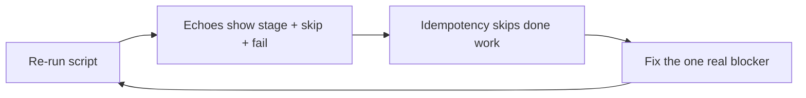
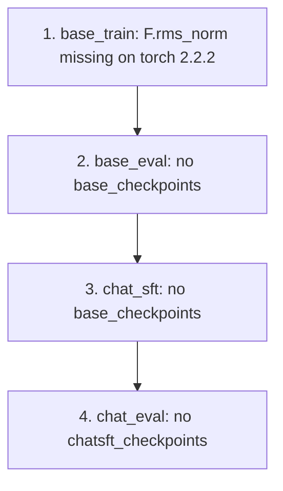
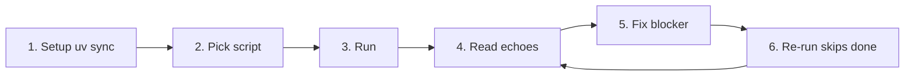
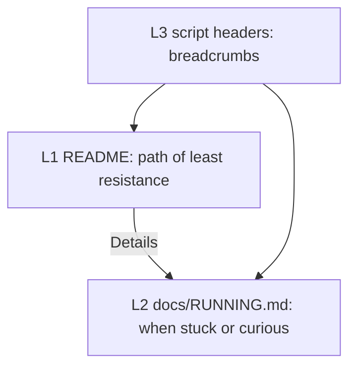

# Echoes + idempotency + fix-forward loop

> **Superseded** by [2026-11-13-fix-forward-mac.md](2026-11-13-fix-forward-mac.md) (merged + reviewer-fixed). Kept for history.

> **Overview:** Triple goal — (1) stage echoes, (2) idempotent resume, (3) fix-forward blockers — plus progressive docs so a reader can smoothly wiz through setup → run → recover without this chat.

## In-repo plan home

Save/version this plan at **[`docs/plan/2026-11-13-echoes-idempotent-resume.md`](docs/plan/2026-11-13-echoes-idempotent-resume.md)** (create `docs/plan/` if needed). That matches the local planning convention (`docs/plan/` for TRAIL/DECISIONS/working plans), separate from user-facing [`docs/RUNNING.md`](docs/RUNNING.md).

- First implementation step: copy the approved plan body into that path (strip Cursor-only frontmatter todos if noisy; keep overview + sections).
- Optional later: `docs/plan/TRAIL.md` slice checklist once execution is underway — not required for this PR’s reader path.
- Do **not** put the working plan under `dev/` (upstream research notes) or only under `~/.cursor/plans/` (not in git).

## Triple goal (how they work together)



1. **Better echoes** — every stage logs START/DONE/SKIP/FAIL with timestamps and artifact paths so you can see behavior and debug without digging through torchrun noise.
2. **Idempotency** — completed stages (tokenizer, checkpoints, eval markers) are skipped on re-run so the script continues from the first unfinished stage.
3. **Fix issues as they appear** — fail-fast on the first real error (no cascade of fake missing-dir failures); fix that blocker; re-run; repeat until the end.

This change set ships (1) and (2) in the run scripts + selective Python boundary echoes, the **current** known blocker (3): `F.rms_norm` on macOS Intel torch 2.2.2, and **progressive docs** (short README + `docs/RUNNING.md` + script header links). Later blockers get the same loop: echo points at the stage → skip keeps progress → fix → re-run.

## What actually failed (today's blocker)

Your log is a **cascade**, not four independent bugs:



- **Root cause:** [`nanochat/gpt.py`](nanochat/gpt.py) line 43 calls `F.rms_norm`, which does not exist on **macOS Intel torch 2.2.2** (pinned in [`pyproject.toml`](pyproject.toml) because newer wheels are unavailable). Failure happens under `torch.compile` / Dynamo as `InternalTorchDynamoError: ... has no attribute 'rms_norm'`.
- **Why the noise:** [`runs/speedrun.sh`](runs/speedrun.sh) has **no `set -e`**, so after `base_train` dies it still runs eval/SFT/eval and prints missing-dir errors.
- **Resume today (this machine’s cache):** **Partial only.** Present: `base_data_climbmix/` (~171 shards) + `tokenizer/`. **Absent:** `base_checkpoints/`, `chatsft_checkpoints/` — `base_train` died on `rms_norm` before any checkpoint write. So a re-run **today** keeps data (download skip), **re-does tokenizer** (no skip yet), and **restarts base_train from step 0**. After this PR: skip tokenizer too and land on `base_train`, then advance stage-by-stage.
- **Side note:** This run used `speedrun.sh` (`torchrun --nproc_per_node=8`, d24, fp8) on a MacBook. Even after the rms_norm fix, prefer [`runs/runcpu.sh`](runs/runcpu.sh) for local learning; speedrun is for 8xGPU nodes. Document that snapshot in README’s resume section so “what’s already done” is clear.

**Scope for this PR:** implement the loop on **speedrun + runcpu** (miniseries/scaling_laws already have `log()`). Prefer `runcpu.sh` on Mac for the educational path; after this lands, workflow is: run → read echo of failed stage → fix → re-run (skips done stages) → repeat.

## 1. Fix current blocker: `rms_norm` for torch < 2.4

In [`nanochat/gpt.py`](nanochat/gpt.py), resolve the implementation once at import time (compile-friendly; avoid per-forward `hasattr`):

```python
if hasattr(F, "rms_norm"):
    def norm(x):
        return F.rms_norm(x, (x.size(-1),))
else:
    def norm(x):
        # torch < 2.4 (e.g. macOS Intel 2.2.2)
        return x * torch.rsqrt(x.pow(2).mean(-1, keepdim=True) + 1e-6)
```

Add a small unit test under `tests/` that exercises `norm` on a tensor (and documents the fallback path when `F.rms_norm` is absent).

## 2. Shell echoes + idempotency — [`runs/speedrun.sh`](runs/speedrun.sh) and [`runs/runcpu.sh`](runs/runcpu.sh)

**Yes — primary echo surface.** Orchestration is almost silent today; this is where stage visibility matters most.

Reuse the timestamped `log()` pattern from [`runs/miniseries.sh`](runs/miniseries.sh):

- `set -euo pipefail` so the first failed stage **stops** the script (kills the cascade).
- Stage banners: `START` / `DONE` / `SKIP` / `FAIL` + elapsed seconds for: setup, dataset, tok_train, tok_eval, wait-download (speedrun), base_train, base_eval, chat_sft, chat_eval (speedrun only).
- Echo key env: `NANOCHAT_BASE_DIR`, device hint, `WANDB_RUN`, and whether each skip gate fired.
- On failure, print which stage died and which artifact is missing/next (one short “resume hint”).

**Artifact-based skip** (idempotent re-run):

- tok_train — skip when `$NANOCHAT_BASE_DIR/tokenizer/tokenizer.pkl` exists
- base_train — skip when any `model_*.pt` under `base_checkpoints/`
- base_eval — skip when base exists **and** marker `base_checkpoints/.eval_ok` (written after successful eval)
- chat_sft — skip when any `model_*.pt` under `chatsft_checkpoints/`
- chat_eval — skip when marker `chatsft_checkpoints/.eval_ok`

Dataset download already skips existing shards; keep that. Force re-run via `FORCE_STAGES=1` (or `FORCE_STAGES=base_train,chat_sft`).

Soft guard in `speedrun.sh`: if no CUDA, `log` a warning pointing at `runcpu.sh` (do not hard-exit).

## 3. Python echoes — boundaries only (not every training step)

**Yes — selective.** Mid-step `print0` in train/eval already exists; we do **not** spam the hot loop. Add echoes only at **entry / dependency / failure** points that help the fix-forward loop:

| Location | What to echo |
|----------|----------------|
| [`nanochat/gpt.py`](nanochat/gpt.py) | Once at import: native `F.rms_norm` vs manual fallback (+ torch version) |
| [`nanochat/checkpoint_manager.py`](nanochat/checkpoint_manager.py) | Before raise: clearer message when checkpoint **dir** missing (path, expected source `base`/`sft`/`rl`, hint to run prior stage) — today’s raw `listdir` FileNotFoundError is why the cascade looked confusing |
| [`scripts/base_train.py`](scripts/base_train.py), [`scripts/chat_sft.py`](scripts/chat_sft.py), [`scripts/base_eval.py`](scripts/base_eval.py), [`scripts/chat_eval.py`](scripts/chat_eval.py) | Startup block via `print0`: torch version, device, `NANOCHAT_BASE_DIR`, load/save roots; on successful end, echo checkpoint/marker path written |
| Keep as-is | Per-step loss/MFU lines, tok_eval tables, chat_cli UI — already sufficient |

**Where else we could add echoes (out of scope this PR unless you want them):**

- `miniseries.sh` / `scaling_laws.sh` — already have `log()`; leave alone
- `dataset.py` / task downloaders — already print skip/download
- `optim.py` / attention / FP8 internals — too noisy for learning the pipeline
- Wandb-only metrics — not terminal echoes

Rule of thumb: **shell = stage map; Python = “what am I about to touch / why did I die.”**

## 4. Docs — progressive disclosure for a smooth reader path

**Success bar:** a new reader can **wiz through** the repo — find the right entry, get set up, start a run, understand logs, recover from a failure, and keep going — without this chat. Docs serve that journey; they are not a brain-dump of the investigation.





### Layer 1 — [`README.md`](README.md) (path of least resistance)

Keep existing Setup + speedrun path. Tighten **Running on CPU / MPS** into a clear “do this next” path (~5–8 lines):

- Mac/CPU/MPS → `bash runs/runcpu.sh` (not `speedrun.sh`).
- Re-runs are safe: completed stages skip; stop on first failure; fix and re-run.
- Link: [docs/RUNNING.md](docs/RUNNING.md) for resume, artifacts, log reading, Mac torch notes.

Do **not** put the full artifact table or cascade autopsy in README — that slows the wiz-through.

Also: in Setup / file-structure, one obvious breadcrumb to `docs/RUNNING.md` so “how do I keep a run alive?” is discoverable without hunting.

### Layer 2 — new [`docs/RUNNING.md`](docs/RUNNING.md) (when stuck or going deeper)

Ordered for the journey (stop when unblocked):

1. **Pick a script** — runcpu vs speedrun vs sweeps (one sentence each) → right command fast.
2. **First run expectations** — what “working” looks like (stage banners, tokenizer then train); rough Mac educational vs GPU speedrun.
3. **Fix-forward loop** — run → first `FAIL` → fix → re-run → repeat until DONE.
4. **What re-run keeps / skips** — artifact map under `NANOCHAT_BASE_DIR`; SFT end-only; optional `--resume-from-step` for base.
5. **Reading the logs** — shell START/DONE/SKIP/FAIL vs Python startup/paths vs step metrics.
6. **Mac / Intel torch** — 2.2.2, `rms_norm` fallback, why laptop+speedrun looked like many failures.
7. **Controls** — `FORCE_STAGES`, `NANOCHAT_BASE_DIR`, `WANDB_RUN`.
8. **Common failure shapes** — missing checkpoint dir ⇒ prior stage never finished.

Link back to README for `uv sync` / install; don’t duplicate setup.

### Layer 3 — script headers (breadcrumbs)

[`runs/runcpu.sh`](runs/runcpu.sh) / [`runs/speedrun.sh`](runs/speedrun.sh): 2–3 comments — who this script is for, fail-fast+idempotent, link `docs/RUNNING.md`.

### Doc quality bar

- **Smooth path first:** each layer answers “what do I do next?” before “why / how deep.”
- Progressive disclosure: L1 never copies L2; L2 never re-teaches `uv sync`.
- Same-commit as behavior; no stale “always restarts from scratch” after skip lands.
- Reader test (mental): cold open README → on Mac in <2 minutes know which command to run and where to look if it fails.

## 5. Verify

- Unit test for `norm` passes on this machine’s torch.
- Dry-check skip logic with existing cache (tokenizer present → log “Skipping tok_train”; no base checkpoints → run/continue at base_train).
- Confirm a failed missing-checkpoint load prints the new friendly message (not only a raw `listdir` error).
- Do **not** claim a full speedrun/runcpu train in this change set; after the fix, resume should land on `base_train` without re-tokenizer.

## Out of scope

- Making SFT mid-run resumable (still end-only checkpoint in Python).
- Changing torch pin above 2.2.2 on Intel Mac (wheels unavailable).
- Full GPU speedrun validation on this laptop.
- Echo spam inside optimizer / attention / every micro-batch.
