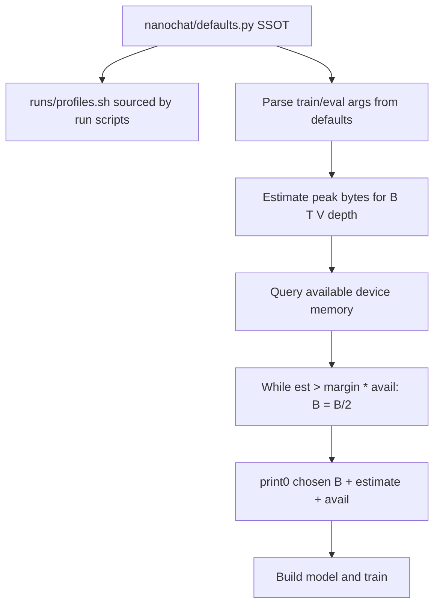

# MPS memory auto-fit + centralized knobs

> **Overview:** Memory preflight/auto-fit for MPS OOM, plus centralize duplicated run knobs (batch/seq/depth/vocab/softcap/margins) so shell + Python share one controllable source — still progressive docs and fix-forward.

## Todos

- [ ] Add `nanochat/defaults.py` + `runs/profiles.sh`; wire argparse/gpt softcap/vocab; runcpu/speedrun source profiles
- [ ] Add `nanochat/memory.py` using defaults margins/vocab; estimate + `fit_device_batch_size` + unit tests
- [ ] Wire `--auto-fit-batch` into base_train/base_eval/chat_sft; MPS empty_cache; nan loss warning
- [ ] runcpu profile: safer `device_batch_size=8`; scripts use profile vars not inline literals
- [ ] RUNNING.md Memory/OOM + Defaults/profiles; README one-liner; update docs/plan

## What the new log shows

Not the earlier `rms_norm` cascade. Training got further, then died on **MPS OOM** at logit softcap:

```515:515:nanochat/gpt.py
logits = softcap * torch.tanh(logits / softcap) # squash the logits
```

Right above that, [`nanochat/gpt.py`](../../nanochat/gpt.py) already notes the hazard: `lm_head` builds `(B, T, vocab)` — a huge tensor. The process was already ~29.6 GiB allocated and tried to add ~3 GiB more (limit ~30.2 GiB).

Also notable: **`loss: nan` at step 200** before the OOM. That means training was already unhealthy; OOM may have hit during a following CORE/eval forward. Treat **nan** as a separate signal (log loudly); memory auto-fit does not fix nan.

Today the README only says: manually lower `--device-batch-size` (32→16→8…). [`runs/runcpu.sh`](../../runs/runcpu.sh) still uses `--device-batch-size=32` with `max-seq-len=512` — fine for some Macs, fatal on others.

**Yes — we can detect/approximate before OOM and auto-configure.** Perfect detection on MPS is hard (unified memory, fragmentation, compile caches); a **conservative estimate + auto-shrink + echoes** is the practical fix-forward step.

**Also yes — extract magic numbers where they are duplicated or user-controllable**, so Mac/memory/profile knobs are not scattered as bare literals across `.sh` and `.py`. Stay minimal (nanochat style): centralize **run profiles + shared model/memory constants**, not every optimizer LR.

## Chosen approach



### 0. Centralize knobs — `nanochat/defaults.py` + `runs/profiles.sh`

**Problem today:** the same ideas appear as disconnected literals, e.g.:

- Shell: [`runs/runcpu.sh`](../../runs/runcpu.sh) `depth=6`, `device-batch-size=32`, `max-seq-len=512`, `total-batch-size=16384`, `num-iterations=5000`; [`runs/speedrun.sh`](../../runs/speedrun.sh) `depth=24`, `device-batch-size=16`; miniseries/scaling_laws hard-code batch tiers 8/16/32
- Python argparse defaults in [`scripts/base_train.py`](../../scripts/base_train.py): `device_batch_size=32`, `max_seq_len=2048`, `eval_tokens=80*524288`, …
- Model: [`nanochat/gpt.py`](../../nanochat/gpt.py) `vocab_size=32768`, `sequence_len=2048`, `softcap = 15`

**SSOT layout (concrete):**

[`nanochat/defaults.py`](../../nanochat/defaults.py) — named constants + small profile dataclasses/dicts:

- Model/shared: `VOCAB_SIZE`, `DEFAULT_SEQ_LEN`, `LOGIT_SOFTCAP`, `MEMORY_FIT_MARGIN` (0.6)
- Train argparse defaults used by scripts: `DEFAULT_DEVICE_BATCH_SIZE`, `DEFAULT_DEPTH`, etc. (import into `base_train` `parser.add_argument(..., default=defaults.X)`)
- Profiles: `PROFILE_RUNCPU`, `PROFILE_SPEEDRUN` as dicts (`depth`, `max_seq_len`, `device_batch_size`, `total_batch_size`, `num_iterations`, `eval_every`, `eval_tokens`, `head_dim`, …)
- Memory module imports `VOCAB_SIZE` / `MEMORY_FIT_MARGIN` from here (no second copy)

[`runs/profiles.sh`](../../runs/profiles.sh) — shell mirror of the two run profiles only (bash cannot import Python without a subprocess):

```bash
# Keep in sync with nanochat/defaults.py PROFILE_* — documented in docs/RUNNING.md
RUNCPU_DEPTH=6
RUNCPU_DEVICE_BATCH_SIZE=8   # safer default; auto-fit may shrink further
RUNCPU_MAX_SEQ_LEN=512
# ...
SPEEDRUN_DEPTH=24
SPEEDRUN_DEVICE_BATCH_SIZE=16
```

[`runs/runcpu.sh`](../../runs/runcpu.sh) / [`runs/speedrun.sh`](../../runs/speedrun.sh): `source` profiles and expand `"--depth=$RUNCPU_DEPTH"` etc. — **no naked magic numbers in the command lines**.

[`nanochat/gpt.py`](../../nanochat/gpt.py): `softcap = LOGIT_SOFTCAP`; `GPTConfig` defaults from `VOCAB_SIZE` / `DEFAULT_SEQ_LEN`.

**Sync rule (documented, light):** Python is canonical for values used in code; `profiles.sh` is canonical for what the shell launches. Add a tiny test or `python -m nanochat.defaults --check-profiles` that asserts shell-exported profile keys match `PROFILE_RUNCPU` / `PROFILE_SPEEDRUN` (parse `profiles.sh` or maintain a generated comment). Prefer one check test over a heavy codegen pipeline.

**Explicitly not in this slice:** every Muon/Adam LR, resid_lambda init formulas, FA3 tile math — leave those in place with their local comments; extract later only if duplicated.

### 1. New helper `nanochat/memory.py`

- `available_memory_bytes(device)`:
  - CUDA: `torch.cuda.mem_get_info`
  - MPS: prefer `torch.mps.recommended_max_memory()` when present; else fall back to a conservative fraction of system RAM (**no new dependency**). Prefer APIs already in torch for the machine’s torch version.
  - CPU: skip auto-fit (or use a large soft cap)
- `estimate_train_peak_bytes(depth, batch, seq_len, vocab_size, dtype)` — order-of-magnitude: params + optimizer state + activations dominated by logits `B*T*V*4` and a small multiplier for fwd/bwd (document the fudge factor; aim conservative).
- `fit_device_batch_size(requested_B, ...)` — halve while estimate exceeds `margin` (default **0.6**) of available; floor at **1**; return `(B, report_dict)`.

### 2. Wire into training/eval startups

- [`scripts/base_train.py`](../../scripts/base_train.py): after args + device known, before heavy alloc: if `--auto-fit-batch` (default **True on mps**, **False on cuda** so speedrun stays unchanged unless opted in), replace `args.device_batch_size` with fitted value; `print0` the report.
- [`scripts/base_eval.py`](../../scripts/base_eval.py) / [`scripts/chat_sft.py`](../../scripts/chat_sft.py): same flag behavior for their `--device-batch-size` (eval often OOMs after train left MPS fragmented — call `torch.mps.empty_cache()` at eval start when device is mps).
- On detect `loss` nan in the train loop: `print0` a clear WARNING (do not silently continue forever); keep existing step line.

### 3. Safer runcpu profile (via centralized knobs)

In `PROFILE_RUNCPU` / `runs/profiles.sh`:

- `device_batch_size=8` (was inline 32)
- Keep `max_seq_len=512`; keep total-batch-size / grad-accum math valid
- Scripts only reference profile vars; startup echoes print the resolved profile name + key knobs

### 4. Docs (progressive)

- L1 README: one line each for MPS auto-fit and “run knobs live in `nanochat/defaults.py` + `runs/profiles.sh`”
- L2 [`docs/RUNNING.md`](../RUNNING.md) (to be added with implementation):
  - **Memory / OOM** — logits dominate, auto-fit, `--auto-fit-batch`, nan warning, watermark env
  - **Defaults and profiles** — what to edit to change educational vs GPU runs; sync rule Python ↔ `profiles.sh`
- Update [`docs/plan/2026-11-13-echoes-idempotent-resume.md`](2026-11-13-echoes-idempotent-resume.md) with blocker #2 (OOM) + knob centralization

### 5. Verify

- Unit test estimate/fit math (no MPS required)
- Unit test / `--check-profiles`: shell profile values match `PROFILE_RUNCPU` / `PROFILE_SPEEDRUN`
- Dry-run print of fitted B for runcpu profile (no full long train required)

## Out of scope

- Perfect MPS fragmentation accounting
- Root-cause fix for **nan loss**
- Extracting every optimizer/init hyperparameter into defaults
- Regenerating miniseries/scaling_laws fully from profiles (only avoid new duplicated literals if we touch those scripts; full sweep refactor later)
- Chunked cross-entropy (gpt.py TODO)

## Relation to existing plan

Same fix-forward loop: **echo → fail clear → auto-adjust → re-run**, plus **one place to turn the dials**. Ship with or after echoes/idempotency/`rms_norm`; memory + defaults are the next Mac blockers once training actually runs.

See also: [2026-11-13-echoes-idempotent-resume.md](2026-11-13-echoes-idempotent-resume.md).
