# CLI stage marking, glossary, and color UX

> **Overview:** Make pipeline stages visually obvious in console/logs (color + compact ASCII stage plaques), teach jargon once per stage with defs+links, keep the frozen echo contract intact, and fix docs so UX/DX follows progressive disclosure (README teaser → RUNNING legend+jargon → deep links).

## In-repo plan home

Canonical copy: [`docs/plan/2026-11-14-cli-learn-color-ux.md`](2026-11-14-cli-learn-color-ux.md) (this file). Cursor working copy may also live under `~/.cursor/plans/cli_learn_color_ux_0992edc9.plan.md` — **this path is the git-tracked SSOT**.

**Status:** PROPOSED  
**slice_id:** `cli-learn-color-ux`  
**Branch:** `feat/cli-learn-color-ux`  
**Worktree:** `.worktrees/cli-learn-color-ux` (from `master`)

### Implementation todos

1. `nanochat/glossary.py` — terms, `STAGE_TERMS`, learn/define formatters + CLI
2. `nanochat/term_style.py` — `NO_COLOR` / non-TTY helpers; color trend better/worse
3. `nanochat/stage_art.py` — script-start banner + compact per-stage plaques; CLI; `NANOCHAT_PLAIN` opt-out
4. Shell: color START/DONE/SKIP/FAIL; ASCII plaque + `learn:` after purpose; blank-line stage blocks
5. Python wire: `emit_define` + metric colors + plaques in `tok_*` / `base_*` / `chat_sft` / `chat_cli`
6. Docs progressive disclosure: README L1 teaser; RUNNING learn/plaque/color + jargon table; fix duplicate TOC blurb
7. Tests + ledger: unit tests for learn/define/color/art; `bash -n` stage lib; GROWTH/PROGRESS entry

---

## Decisions (locked)

- **Definitions:** once per stage — a stage briefing at `START`, plus fail-soft mid-stage `define:` only if a Python script is run alone (no shell briefing yet).
- **Color:** shell stage lines + enrichment prefixes + metric / trend highlights. Respect `NO_COLOR` and non-TTY (plain text for CI / redirected logs).
- **ASCII art:** welcome — compact, stage-scoped plaques + one script-start banner. Art is an **enrichment** (never replaces contract lines). Opt out with `NANOCHAT_PLAIN=1` (logs stay greppable without boxes). Art stays on when redirected (helps scrolling saved logs); color still follows TTY/`NO_COLOR`.
- **Contract:** do **not** change the frozen `START` / `DONE` / `SKIP` / `FAIL` / `FORCE` text shapes in [`runs/_stage_lib.sh`](../../runs/_stage_lib.sh); only wrap them in color and add enrichment lines / plaques above them.

## Goals

When someone scrolls a console or log file they should instantly see **which stage** is running, **what it is for**, and **what jargon means** — without drowning long train loops in repeated defs. ASCII plaques make stage boundaries pop; color reinforces status.

```mermaid
flowchart LR
  scriptStart["runcpu/speedrun start"] --> banner["ASCII nanochat banner"]
  banner --> pipeline["pipeline map"]
  pipeline --> tipKnob["tip + knob diff"]
  tipKnob --> plaque["ASCII stage plaque"]
  plaque --> stageStart["colored START"]
  stageStart --> purpose["purpose · health"]
  purpose --> learn["learn: stage terms + links"]
  learn --> python["Python stage work"]
  python --> metrics["colored metrics + optional define"]
  metrics --> stageDone["colored DONE plaque / FAIL"]
```



## 1. Glossary SSOT — `nanochat/glossary.py`

New pure-stdlib module (same pattern as [`nanochat/run_tip.py`](../../nanochat/run_tip.py) / [`nanochat/metrics_trend.py`](../../nanochat/metrics_trend.py)):

- Term catalog with short ELI15 blurb + URL, at least:
  - **BPE**, **BPB** / **val_bpb**, **CORE**, **ChatCORE**, **MFU**, **Muon**, **FLOPs**, **compression ratio**, **vocab**, **softcap**, **DDP** (only if printed)
- `STAGE_TERMS`: map stage name → ordered term keys
  - `tok_train` → BPE, vocab
  - `tok_eval` → BPE, compression
  - `base_train` → BPB, Muon, MFU, FLOPs
  - `base_eval` → BPB, CORE
  - `chat_sft` → ChatCORE, BPB, Muon
  - `chat_eval` → ChatCORE
- `format_learn_line(stage) -> str` → one packed enrichment:
  `learn: BPE — … (https://…) · BPB — … (https://…)`
- `emit_define(term, print_fn)` — once per process (in-memory set); line shape `define: BPB — … · https://…`
- CLI: `python -m nanochat.glossary learn --stage base_train` for shell (mirrors tip/last_run)

Prefer stable public links (e.g. Wikipedia BPE; Karpathy / DCLM / nanochat README anchors for CORE/BPB where possible).

## 2. ASCII stage art — `nanochat/stage_art.py`

Pure-stdlib SSOT for impactful-but-sparse art (reuse spirit of existing [`print_banner`](../../nanochat/common.py) DOS Rebel; do **not** reprint the huge banner every stage).

- **Script-start banner** (once per `runcpu.sh` / `speedrun.sh`): slim variant or call existing `print_banner` once at script top via `python -m nanochat.stage_art banner`.
- **Per-stage plaque** (3–5 lines, box-drawing, ASCII-safe fallback with `+`/`-`/`|` if needed): printed **before** the frozen `START`/`DONE`/`SKIP`/`FAIL` line.

Example shapes (illustrative — exact glyphs live in code):

```text
  +========================================+
  |  >>  STAGE  base_train                 |
  |  teach raw next-token prediction       |
  +========================================+
```

```text
  +----------------------------------------+
  |  OK  DONE  base_train   elapsed=71m    |
  +----------------------------------------+
```

```text
  +########################################+
  |  !!  FAIL  base_train   exit=1         |
  +########################################+
```

- Roles: `start`, `done`, `skip`, `fail`, `force` — different border/label so log greps on `STAGE` / `DONE` / `FAIL` still work inside the plaque.
- CLI: `python -m nanochat.stage_art plaque --stage base_train --kind start` (shell fail-soft).
- `NANOCHAT_PLAIN=1` → no plaques/banner (contract + learn/define still print).
- Discipline: **one plaque per stage event**, never per train step; no emoji; no giant multi-font walls mid-run.

## 3. Stronger stage marking (shell)

In [`runs/_stage_lib.sh`](../../runs/_stage_lib.sh):

- Add small `c_*` / `paint()` helpers: enable color only if stdout is a TTY and `NO_COLOR` is unset.
- Color `log` lines by kind without changing tokens:
  - `START` / `FORCE` → bold cyan
  - `DONE` → bold green
  - `SKIP` → dim yellow
  - `FAIL` → bold red
- Emission order at a stage boundary: blank line → **ASCII plaque** → frozen `log "START …"` → `purpose · health` → `learn:` …
- After the existing packed `purpose: … · health: …` line, print one indented `learn:` line via `python -m nanochat.glossary learn --stage "$stage"` (fail-soft, like tip).
- On DONE/SKIP/FAIL: matching plaque (with elapsed / reason when known) **above** the contract line; color the plaque when TTY.
- Script start (`runcpu` / `speedrun`): print banner once before `pipeline:`.
- Lightly color enrichment prefixes (`purpose:`, `learn:`, `tip:`, `pipeline:`, `next:`) when color is on.

Frozen shapes in [`docs/RUNNING.md`](../RUNNING.md) §5 stay the source of truth; document that color/ASCII are cosmetic enrichments (`NO_COLOR`, `NANOCHAT_PLAIN`).

## 4. Color + define + solo plaques in Python

Add [`nanochat/term_style.py`](../../nanochat/term_style.py) (or thin helpers in [`nanochat/common.py`](../../nanochat/common.py) if kept small):

- `enabled()`, `paint(role, text)`, roles: `start`, `done`, `fail`, `metric`, `better`, `worse`, `define`, `warn`, `art`
- Teach [`print0`](../../nanochat/common.py) nothing magic by default — call sites / helpers apply paint so tests stay deterministic when color off.
- Keep [`print_banner`](../../nanochat/common.py) as the big identity mark for `base_train`; stage plaques are the small repeating markers. Optionally route banner through `stage_art` so script shell + Python share one SSOT.

Wire mid-stage teaching + color at first metric print (emit-once; no per-step spam):

| Script | Action |
|--------|--------|
| [`scripts/tok_train.py`](../../scripts/tok_train.py) | Solo: stage plaque + `define` BPE; color key prints |
| [`scripts/tok_eval.py`](../../scripts/tok_eval.py) | Define compression / BPE; color ratio lines |
| [`scripts/base_train.py`](../../scripts/base_train.py) | Color `Validation bpb` / `CORE metric` / train step `mfu`; `emit_define` once for bpb/CORE/mfu/Muon near first use; color `trend:` better/worse via [`metrics_trend.py`](../../nanochat/metrics_trend.py) |
| [`scripts/base_eval.py`](../../scripts/base_eval.py) | Compact ASCII section headers for BPB / CORE / Samples (replace bare `====` walls with stage_art section frames); define once |
| [`scripts/chat_sft.py`](../../scripts/chat_sft.py) | Same for val bpb / ChatCORE / mfu |
| [`scripts/chat_cli.py`](../../scripts/chat_cli.py) | Small chat welcome plaque; color `User:` / `Assistant:` labels only |

`emit_metric_trend` should paint “better” green / “worse” red when color enabled.

## 5. Docs UX / DX — progressive disclosure (audit + fix)

Docs are part of this slice: console teaches in the moment; docs let you pull more without dumping everything in README.

### Current state (audit)

| Layer | Today | Gap |
|-------|-------|-----|
| L0 console | enrichments (`tip:`, `purpose:`, `trend:`) | No `learn:` / plaques / color yet (this plan) |
| L1 README | Short [CPU/MPS](../../README.md#running-on-cpu--mps) bullets → link to RUNNING | No one-liner that logs teach jargon; `val_bpb`/`CORE` named in Research without a “what is that?” pull-link |
| L2 RUNNING | Solid how-to + echo legend + enrichment glossary | Enrichment glossary covers log *prefixes*, not ML *terms* (BPE/BPB/CORE); no “how to read a stage block” with plaque/color; duplicate “How-to first…” blurb under TOC |
| L3 deep | External guides / papers via README Guides | Fine — keep linking out; do not paste papers into RUNNING |

### Target disclosure ladder

1. **Console (L0):** stage plaque → START → purpose → `learn:` (short def + link) → work → colored metrics. Enough to learn while watching.
2. **README (L1):** one extra bullet under CPU/MPS (and/or a tiny “Reading the logs” note): stages are marked; unusual terms print a def + link; details in RUNNING. Do **not** grow README into a glossary.
3. **RUNNING (L2):**
   - Fix duplicate TOC intro paragraph.
   - Extend §5/§6: document plaques, color roles, `learn:` / `define:`, `NO_COLOR`, `NANOCHAT_PLAIN`.
   - Add a compact **Jargon** subsection (or §6b) — same terms as `glossary.py` SSOT spirit: term · plain meaning · when you see it · link. Table stays skim-friendly (one screen).
   - Optional “Example stage block” fenced diagram (ASCII plaque + START + purpose + learn + DONE) so DX matches what the console will look like.
4. **Deeper (L3):** links in the jargon table / `learn:` lines only — Wikipedia, DCLM, README Research anchors — no new long explanation doc unless jargon table overflows.

### DX checks (must pass before done)

- Stuck runner can stay on one RUNNING page (existing design) and find: contract legend, enrichments, jargon, controls.
- Grep/TOC: new terms appear in RUNNING contents line.
- No Diataxis collapse: README stays entry; RUNNING stays how-to+reference; no tutorial essay in README.
- Console strings and RUNNING jargon table stay aligned (same term keys / links as `nanochat/glossary.py`).

## 6. Tests + ledger

- [`docs/plan/GROWTH.md`](GROWTH.md) / PROGRESS: short entry for this slice.
- Tests (pure, no torch):
  - `format_learn_line` includes stage terms + `https://`
  - `emit_define` prints once then silence
  - color helpers return plain text when `NO_COLOR=1` or forced off
  - plaque contains stage name + kind label; `NANOCHAT_PLAIN=1` yields empty/no art
  - shell: `bash -n` on `_stage_lib.sh`; optional assert `learn` + `plaque` CLIs print for `base_train`
  - Lightweight doc assert optional: RUNNING.md mentions `learn:` and jargon terms present in glossary SSOT (grep test)

## Out of scope

- Changing START/DONE/SKIP/FAIL field order or wording
- Per-step definition spam / tip rotation / giant figlet every train step
- Web UI (this repo is CLI/shell)
- Heartbeat / ETA train-loop work (still deferred)
- Full DIVIO restructure into `docs/tutorials|howto|…` trees (keep single L2 RUNNING)

## Implementation order

1. `glossary.py` + `term_style.py` + `stage_art.py` + unit tests
2. Shell color + plaques + `learn:` in `_stage_lib.sh` (+ banner at script start)
3. Python call-site define/color/section-frame wiring
4. Docs progressive disclosure: README teaser + RUNNING jargon/plaque/color + fix duplicate blurb
5. Smoke: `glossary learn`, `stage_art plaque`, color off/on, `NANOCHAT_PLAIN=1`
