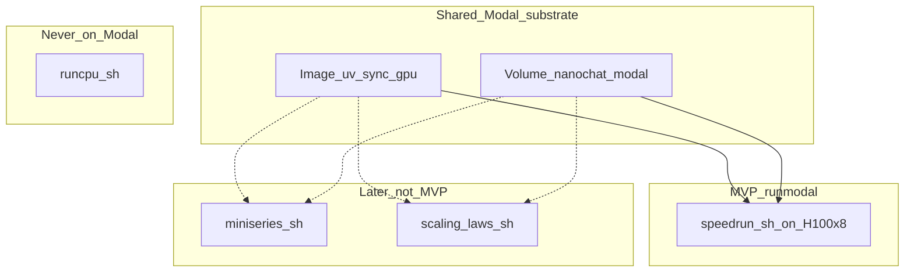
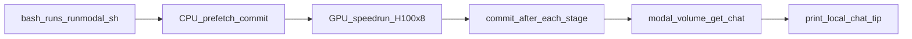

# Modal nanochat — consolidated plan (post-review)

> **Overview:** One `runmodal` wraps `speedrun.sh` on Modal 8×H100; existing script edits are env-opt-in so **local CPU**, **local GPU**, and **Modal** all keep working; wait-for-ack Volume commits; auto-download chat model; docs for new/existing users.

## In-repo plan home

Canonical copy: [`docs/plan/2026-11-14-modal-nanochat-minimum.md`](2026-11-14-modal-nanochat-minimum.md) (this file). Cursor working copy may also live under `~/.cursor/plans/` — **this path is the git-tracked SSOT**.

### Implementation todos

1. Triple-mode-safe shell: honor `NANOCHAT_BASE_DIR`; `SKIP_SETUP` + activate-if-`.venv`; `NANOCHAT_POST_STAGE_HOOK` no-op when unset
2. `runs/runmodal.sh` + `runs/modal_run.py`: Modal sets env; timeouts; wait-for-ack; H100:8; volume get; chat tip
3. README / `docs/MODAL.md` / RUNNING.md: three modes, cost, no SMOKE, env opt-in
4. Verify: runcpu + bare speedrun unchanged when Modal env unset; Modal path with env set

---

This plan is the SSOT for the Modal thread **plus** critic fixes **plus** analysis of every script under [`runs/`](../../runs/).

## Reviewer status (latest pass)

| Reviewer | Verdict | Disposition |
|----------|---------|-------------|
| [Critic](17a4f425-d7bc-4178-9e79-c7d8c7cfd18d) (round 3) | **APPROVE** | Prior blockers closed; minors folded (bash -c, wait-for-ack) |
| [Architect](050ca362-05d5-42f6-b5ac-311698e117dd) (platform/solution) | **REQUEST_CHANGES** → applied | Wait-for-ack; pin debian_slim + ignore + required PYTHONPATH |
| [Planner/PO](89c54e49-98ac-4d22-8869-1854f51c57e3) | **REQUEST_CHANGES** → applied | Cost on README/`runmodal.sh` header; §9 SFT-fail check |
| [Document-specialist](5f95a40b-add2-49a8-859c-4112f22eb616) | **APPROVE** | Diataxis howto OK; polish: no-SMOKE + SKIP_SETUP in MODAL.md |
| nWave specialized reviewers | Quota-blocked | Criteria covered via architect/PO/docs/critic stand-ins |

### Fixes applied (all rounds)

| Severity | Finding | Plan decision |
|----------|---------|---------------|
| Blocker | Modal default timeout 300s | Prefetch ≥1h, GPU ≥4h |
| Blocker | SMOKE + 1×H100 vs nproc=8 | Drop SMOKE from MVP; do not document |
| Blocker | Hook “signals parent” / touch≠durable | **Wait-for-ack** trigger file + daemon `vol.commit()` before next stage |
| Major | SKIP_SETUP vs activate | Same flag name; **activate iff `.venv` exists** (local/miniseries yes; Modal image no `.venv` → PATH) |
| Major | Image under-specified / cu128 mismatch | **debian_slim** + gpu `uv_sync`; ignore `.venv`/`.git`; **required** `PYTHONPATH` |
| Major | Commit only at end | Per-stage wait-for-ack + final commit |
| Major | Cost only in deep §10 | Cost on README blurb + `runmodal.sh` header |
| Major | Prefetch/GPU Volume/env | Same Volume + env before Python both funcs |
| Minor | volume get / tip / SFT fail verify | Concrete get paths; local tip; §9.8 fail check |

## 0. How each `runs/` script maps to Modal

From the current tree: `_stage_lib.sh`, `profiles.sh`, `runcpu.sh`, `speedrun.sh`, `miniseries.sh`, `scaling_laws.sh`.

| Script | Role today | Optimal on Modal? | MVP? |
|--------|------------|-------------------|------|
| [`speedrun.sh`](runs/speedrun.sh) | Full GPT-2-grade pipeline on **blank 8×H100**; hardcoded `nproc_per_node=8`, `--fp8`, 170 shards, stage markers via `_stage_lib` | **Yes — primary.** One 8×H100 job + Volume. Needs honor-`NANOCHAT_BASE_DIR` + `SKIP_SETUP=1` (image owns deps). Prefetch shards on CPU first so GPU time is FLOPs not HF download. | **Yes** (`runmodal.sh` wraps this) |
| [`runcpu.sh`](runs/runcpu.sh) | Mac/CPU/MPS demo; `uv sync --extra cpu`; single-process; depth 6; 8 shards; no torchrun | **No.** Wrong extra (cpu), wrong scale, burns money for a weak model. Keep laptop-only. | No |
| [`_stage_lib.sh`](runs/_stage_lib.sh) | Shared SKIP/FORCE/logging for runcpu+speedrun | **Indirect yes.** Comes along when calling speedrun; markers under Volume `NANOCHAT_BASE_DIR` make Modal re-runs idempotent. Do not invent a second skip layer. | Via speedrun |
| [`profiles.sh`](runs/profiles.sh) | Emitted knobs (`SPEEDRUN_*` / `RUNCPU_*`) from `defaults.py` | **Use SPEEDRUN_* only on Modal.** Never export RUNCPU profile into a Modal GPU job. | Via speedrun |
| [`miniseries.sh`](runs/miniseries.sh) | Research sweep depths 12…26; **already has `SKIP_SETUP=1`**; `NPROC_PER_NODE` configurable; downloads **1000** shards; CSV under base dir; no `_stage_lib` | **Later yes.** Same image+Volume; either one long 8×H100 job or one Modal function per depth (CSV on Volume = natural resume). Align speedrun’s skip flag name with this (`SKIP_SETUP`). Honor-`NANOCHAT_BASE_DIR` needed (today hardcodes). | No (out of MVP) |
| [`scaling_laws.sh`](runs/scaling_laws.sh) | FLOPs×depth grid; **already honors** `NANOCHAT_BASE_DIR`; assumes `.venv` active; `NPROC_PER_NODE`; CSV `run_exists` skip | **Later yes.** Best Modal fit for many short-ish 8-GPU jobs sharing Volume + CSV idempotency. No image bootstrap in script. | No (out of MVP) |

### Optimal Modal pattern (from the scripts)



**Takeaways for implementation:**

1. **MVP = wrap `speedrun.sh` only** — end-to-end “train then chat”; one-command UX.
2. **`SKIP_SETUP` flag name from miniseries** — semantics per **§0.1** (activate iff `.venv` exists).
3. **speedrun keeps `nproc_per_node=8`** — no 1-GPU smoke in MVP.
4. **Prefetch + skip-if-exists** — in-script `dataset -n` near-no-op after CPU prefetch.
5. **miniseries/scaling_laws later** — same base-dir honor; never call them from runmodal MVP.
6. **Never run `runcpu.sh` on Modal** — local CPU/MPS only.

### 0.1 Triple-mode invariant (required)

Edits to **existing** scripts (`speedrun.sh`, `runcpu.sh`, `_stage_lib.sh`, `miniseries.sh`, …) must keep **all three** environments working. Modal-only behavior is **opt-in via env vars**. When those vars are unset, behavior matches today’s local defaults.

| Mode | User command | Existing-script requirement |
|------|--------------|------------------------------|
| **Local CPU / MPS** | `bash runs/runcpu.sh` | Default cache; `uv sync --extra cpu`; no Modal hooks |
| **Local GPU** | `bash runs/speedrun.sh` (bare 8×H100) | Default cache; full uv/venv/sync + activate when `SKIP_SETUP` unset; CUDA check; 8-way train; stage SKIP |
| **Modal** | `bash runs/runmodal.sh` | Same `speedrun.sh`; Modal sets `NANOCHAT_BASE_DIR`, `SKIP_SETUP=1`, `HF_HOME`, `NANOCHAT_POST_STAGE_HOOK` |

**Env opt-in (no silent default flips):**

| Variable | Unset (local default) | Set (Modal / advanced) |
|----------|----------------------|-------------------------|
| `NANOCHAT_BASE_DIR` | `$HOME/.cache/nanochat` | Caller path (Volume or download cache) |
| `SKIP_SETUP` | Install/venv/sync as today | Skip install/sync; **if `.venv` exists → activate** (local / miniseries); **if not → PATH** (Modal image) |
| `NANOCHAT_POST_STAGE_HOOK` | No-op | After successful stage; fail → delete marker |
| `FORCE_STAGES` | Unchanged | Unchanged |

Forbidden: detect Modal via hostname/`/data`; import `modal` from `_stage_lib`/speedrun. Cloud wiring lives only in `runmodal.sh` / `modal_run.py`.

## 1. Goals

1. Whole process on Modal = [`runs/speedrun.sh`](runs/speedrun.sh) stages.
2. Download chat model; local `chat_cli`.
3. Separate caches: local vs Volume vs `~/.cache/nanochat-modal`.
4. Thin wrapper; reuse scripts; no second training stack.
5. Docs for new and existing users.
6. Volume-backed idempotent data + stage markers.
7. Local idempotent features work on Modal.
8. One command: `bash runs/runmodal.sh`.
9. Profile → 8×H100; never runcpu/CPU train on Modal.
10. **Existing script changes work for Modal + local CPU + local GPU** (§0.1).

## 2. Non-goals

- Multi-node clusters; vendoring community modal fork; porting `runcpu` to Modal
- New skip system; spot/preemption fancy resume; hyperparam changes
- **SMOKE / 1×H100 path in MVP** (incompatible with stock `speedrun.sh` 8-way torchrun without extra knobs)
- Mid-train `--resume-from-step` as required MVP (stage-boundary resume only, same as local)

## 3. FAQ

| Question | Answer |
|----------|--------|
| Download and chat locally? | Yes — tokenizer + SFT → `NANOCHAT_BASE_DIR=~/.cache/nanochat-modal python -m scripts.chat_cli` |
| Separate from Mac runs? | Yes — three distinct roots above |
| Where do data files land? | Volume `…/base_data_climbmix/` (~170 shards / ~17GB); CPU prefetch |
| Idempotent? | Yes — `dataset.py` + `_stage_lib.sh` markers; re-run SKIPs finished work |
| One command? | `bash runs/runmodal.sh` |
| Avoid 3h CPU? | Yes — always 8×H100 speedrun; never runcpu on Modal |
| Do script edits break local CPU/GPU? | **No** — §0.1: Modal opts are env-only; unset = today’s `runcpu` / bare `speedrun` |

## 4. UX

```bash
# Local
bash runs/runcpu.sh       # Mac demo (slow)
bash runs/speedrun.sh     # bare-metal 8xH100

# Modal — one command
bash runs/runmodal.sh
# → CPU prefetch 170 shards on Volume (commit)
# → GPU H100:8 with SKIP_SETUP=1 bash runs/speedrun.sh (commit per stage)
# → modal volume get tokenizer + chatsft_checkpoints → ~/.cache/nanochat-modal
# → tip: NANOCHAT_BASE_DIR=~/.cache/nanochat-modal python -m scripts.chat_cli -p "Why is the sky blue?"
```

Prerequisites once: Modal account, `modal setup`, **8×H100** entitlement, local `modal` CLI (`pip install modal` or uv tool).



## 5. Storage map

| Role | Path |
|------|------|
| Mac / runcpu | `~/.cache/nanochat` |
| Modal Volume (`nanochat-modal`) | `/data/nanochat-modal` |
| ClimbMix | `/data/nanochat-modal/base_data_climbmix/` |
| Markers / tokenizer / checkpoints | Same Volume tree |
| HF caches | `/data/nanochat-modal/hf_home` (`HF_HOME`) |
| Laptop chat copy | `~/.cache/nanochat-modal` |

Chat minimum: `tokenizer/` + `chatsft_checkpoints/`. If SFT never finished, **do not** present a success tip; fail the download step with a clear message.

## 6. Idempotency

- Shards: skip-if-exists in [`nanochat/dataset.py`](nanochat/dataset.py).
- Stages: markers in [`runs/_stage_lib.sh`](runs/_stage_lib.sh); `FORCE_STAGES` unchanged.
- Prefetch + in-script `dataset -n` both OK if same Volume + base dir (second call no-ops).
- **Invariant:** set `NANOCHAT_BASE_DIR` / `HF_HOME` in the process environment **before** any `python -m` (dataset binds `DATA_DIR` at import).
- **Commits:** after prefetch; **after each successful stage** (not only end). Mid-stage kill still loses the current stage (same as missing `.train_ok` locally).

## 7. Hardware and image

| Clock | Policy |
|-------|--------|
| Image | Concrete layout below. No ClimbMix/train in image build. |
| Train | Always `gpu="H100:8"`. Never CPU train. Never size from local Mac. |

**Image recipe (required — pinned):**

- Base: **`debian_slim` + Python 3.11** + `uv_sync(extras=["gpu"], frozen=True)` against lockfile (pytorch-cu128 wheels; Modal supplies host GPU drivers). Do **not** use `nvidia/cuda:12.4.1-devel` unless CUDA match with cu128 is proven.
- Remote repo root: **`/root/nanochat`**. Last layer: `add_local_dir(".", remote_path="/root/nanochat", ignore=[".venv", ".git", "**/.pytest_cache", "**/__pycache__"])` so a local Mac cpu `.venv` cannot clobber the image.
- Function `cwd="/root/nanochat"`. **`PYTHONPATH=/root/nanochat` required** (`uv_sync` is `--no-install-project`).
- Invariant: image PATH already exposes that env’s `python` / `torchrun` without `source .venv`.

Timeouts (required):

- Prefetch: `timeout=60*60`
- GPU: `timeout=4*60*60`

`SKIP_SETUP=1` on speedrun: skip uv install / venv create / `uv sync`; then **activate `.venv` only if it exists**, else use PATH (Modal image). Aligns miniseries (has `.venv`) and Modal (no project `.venv`). Keep CUDA refuse-check + pipeline. Unset `SKIP_SETUP` = today’s full bootstrap (local GPU).

Volume: `modal.Volume.from_name("nanochat-modal", create_if_missing=True)` mounted at `/data/nanochat-modal` (= `NANOCHAT_BASE_DIR`).

CPU only for prefetch (I/O). FLOPs on GPU.

## 8. Deliverables

### 8.1 Shell changes

Honor pre-set base dir (same default) in [`runs/speedrun.sh`](runs/speedrun.sh), [`runs/runcpu.sh`](runs/runcpu.sh), and [`runs/miniseries.sh`](runs/miniseries.sh):

```bash
export NANOCHAT_BASE_DIR="${NANOCHAT_BASE_DIR:-$HOME/.cache/nanochat}"
```

In `speedrun.sh`: if `SKIP_SETUP=1`, skip uv/venv create/`uv sync`; if `.venv` exists then activate, else use PATH. Still run CUDA check + pipeline. Unset = full bootstrap (local GPU unchanged).

In [`runs/_stage_lib.sh`](runs/_stage_lib.sh) `run_stage`:

- On **SKIP**: do not run hook.
- On **success**: if `NANOCHAT_POST_STAGE_HOOK` is set, run it. If the hook fails: **delete that stage’s success marker**, then fail the stage (non-zero) so a re-run does not false-SKIP without a durable Volume commit.
- Hook unset: no-op (local unchanged).

**Concrete Modal hook recipe (wait-for-ack — required):**

1. GPU Modal function starts a **daemon thread** before `subprocess` of `speedrun.sh`.
2. Protocol:
   - Hook (via `bash -c`, after stage markers written): write `$NANOCHAT_BASE_DIR/.modal_commit_request`, then **poll until** that file is gone (or until `.modal_commit_failed` appears) with a timeout.
   - Daemon: on request file → `vol.commit()` → on success **remove** request file; on failure write `.modal_commit_failed` and leave request (or clear after marking failed).
3. Hook returns non-zero if commit fails / times out → `_stage_lib` **deletes stage marker** and fails the stage.
4. Next stage must not start until the prior hook returns success (wait-for-ack barrier).
5. After speedrun subprocess exits: final `vol.commit()`; clear leftover request/failed files.
6. Modal background volume commits are a **safety net only** — not a substitute for this barrier or §9.6.

Export hook via env **dict** into subprocess (avoid fragile shell one-liner quoting), e.g.  
`NANOCHAT_POST_STAGE_HOOK` = `bash -c 'touch "$NANOCHAT_BASE_DIR/.modal_commit_request"; … poll …'`.

### 8.2 `runs/runmodal.sh` + `runs/modal_run.py`

`runmodal.sh`: require `modal` on PATH; print short audience header including **cost ballpark** (~$40–60 for full 8×H100; first run higher for image/compile); `modal run runs/modal_run.py`; fail-fast.

`modal_run.py` local entrypoint:

1. Prefetch (CPU, Volume `nanochat-modal` `create_if_missing=True`, mount `/data/nanochat-modal`, env set, `cwd=/root/nanochat`, timeout ≥1h): `dataset -n 170` → `vol.commit()`.
2. Train (GPU `H100:8`, same Volume/env/cwd, timeout ≥4h): start commit-watcher thread with wait-for-ack protocol; run speedrun with `SKIP_SETUP=1`, `NANOCHAT_BASE_DIR`, `HF_HOME`, `NANOCHAT_POST_STAGE_HOOK` via env dict; then final `vol.commit()`.
3. On success: `modal volume get nanochat-modal /tokenizer ~/.cache/nanochat-modal/tokenizer` and `/chatsft_checkpoints` → `~/.cache/nanochat-modal/chatsft_checkpoints` (volume root == mount root == `NANOCHAT_BASE_DIR`).
4. Print **local** chat tip with `NANOCHAT_BASE_DIR=~/.cache/nanochat-modal` (treat in-container speedrun tip as noise).
5. On missing SFT artifacts: non-zero exit; no fake success tip.

Both Modal functions: identical Volume name/mount, `NANOCHAT_BASE_DIR`, `HF_HOME`, `cwd=/root/nanochat`. **Do not** call `runcpu.sh`, `miniseries.sh`, or `scaling_laws.sh` in MVP.

### 8.3 Docs

- **Type:** [`docs/MODAL.md`](docs/MODAL.md) is a **howto** (run Modal end-to-end). Short storage table + which `runs/*` scripts apply (speedrun via runmodal; runcpu local-only; miniseries/scaling later). Do not collapse into a full architecture essay. **Do not document SMOKE** as a supported path.
- **README:** “Cloud GPU (Modal)” pointer → `bash runs/runmodal.sh` **plus one-line cost** (~$40–60; first run higher). Users must see cost on the entry surface, not only in §10.
- **Three modes in docs:** local CPU (`runcpu`), local GPU (`speedrun`), Modal (`runmodal`) — existing script edits are env opt-in (§0.1).
- **New users (MODAL.md):** prerequisites, cost + first-bake, one command, chat tip, idempotent re-runs, Modal ≠ runcpu.
- **Existing Mac / bare-metal GPU users:** `runcpu` / `speedrun` unchanged when Modal env unset; caches do not collide.
- **RUNNING.md §9:** pre-set `NANOCHAT_BASE_DIR`; `SKIP_SETUP` (activate iff `.venv`); `NANOCHAT_POST_STAGE_HOOK` no-op when unset; link MODAL.md.

## 9. Verification

1. Prefetch + GPU jobs do not die with Modal’s default 300s timeout.
2. Successful run leaves chat files under `~/.cache/nanochat-modal`; printed tip works for `chat_cli`.
3. Second `runmodal`: shard skips + stage SKIPs; download refreshes local chat dir.
4. **Local CPU:** with Modal env unset, `bash runs/runcpu.sh` still uses default bootstrap + `~/.cache/nanochat` (smoke: script starts / SKIP logic; full train optional).
5. **Local GPU:** with Modal env unset, `bash runs/speedrun.sh` still runs uv/venv/sync + activate (dry-check or short path); no accidental `SKIP_SETUP`/hook.
6. **Modal:** `SKIP_SETUP=1` without project `.venv` uses image PATH; no fighting second venv; wait-for-ack commits work.
7. Kill after `base_train` success **and wait-for-ack commit completed**: re-run SKIPs `base_train`.
8. Image does not full-rebuild torch layer on code-only edits.
9. If `chatsft_checkpoints` missing after remote run: non-zero exit, **no** success tip.
10. `_stage_lib` with `NANOCHAT_POST_STAGE_HOOK` unset: zero overhead / no-op (runcpu + local speedrun).

## 10. Cost / ops (docs)

- Full: ~$40–60 at ~$3/GPU/hr × 8 × ~1.5–2h; **first run higher** (image bake + compile).
- Wandb optional via Modal Secret; default dummy/disabled.
- H100 queue / entitlement failures: fail clearly at start.
