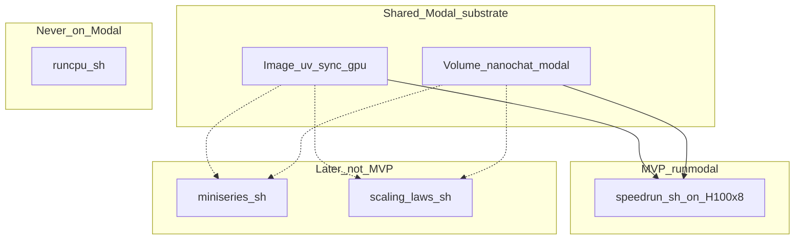
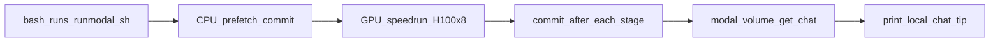

# Modal nanochat — consolidated plan (post-review)

> **Status (2026-11-15): OPEN.** Code merged on master. The merge gates are not met: live CPU run gates C1-C6 have no evidence yet, and C9 (reviewer sign-off on the final commit) is pending. Auto-download depth bug (`runs/modal_run.py` looks only at the top of `chatsft_checkpoints/`) is documented in `docs/MODAL.md`, not fixed.


> **Overview:** One `runmodal` wraps `speedrun.sh` on Modal 8×H100; existing script edits are env-opt-in so **local CPU**, **local GPU**, and **Modal** all keep working; wait-for-ack Volume commits; auto-download chat model; docs for new/existing users.

## In-repo plan home

Canonical copy: [`docs/plan/2026-11-14-modal-nanochat-minimum.md`](2026-11-14-modal-nanochat-minimum.md) (this file). Cursor working copy may also live under `~/.cursor/plans/` — **this path is the git-tracked SSOT**.

### Implementation todos

1. Triple-mode-safe shell: honor `NANOCHAT_BASE_DIR`; `SKIP_SETUP` + always `source .venv/bin/activate`; `NANOCHAT_POST_STAGE_HOOK` no-op when unset
2. `runs/runmodal.sh` + `runs/modal_run.py`: Modal sets env; timeouts; wait-for-ack; H100:8; volume get; chat tip
3. README / `docs/MODAL.md` / RUNNING.md: three modes, cost, no SMOKE, env opt-in
4. Verify: runcpu + bare speedrun unchanged when Modal env unset; Modal path with env set

---

This plan is the SSOT for the Modal thread **plus** critic fixes **plus** analysis of every script under [`runs/`](../../runs/).

## Reviewer status (latest pass)

| Reviewer | Verdict | Disposition |
|----------|---------|-------------|
| [Critic](17a4f425-d7bc-4178-9e79-c7d8c7cfd18d) (round 3) | **APPROVE** | Prior blockers closed; minors folded (bash -c, wait-for-ack) |
| [Architect](050ca362-05d5-42f6-b5ac-311698e117dd) (platform/solution) | **REQUEST_CHANGES** → applied | Wait-for-ack; pin debian_slim + ignore + required PYTHONPATH |
| [Planner/PO](89c54e49-98ac-4d22-8869-1854f51c57e3) | **REQUEST_CHANGES** → applied | Cost on README/`runmodal.sh` header; §9 SFT-fail check |
| [Document-specialist](5f95a40b-add2-49a8-859c-4112f22eb616) | **APPROVE** | Diataxis howto OK; polish: no-SMOKE + SKIP_SETUP in MODAL.md |
| nWave specialized reviewers | Quota-blocked | Criteria covered via architect/PO/docs/critic stand-ins |
| nWave product-owner-reviewer (2026-11-14) | **REQUEST_CHANGES** → applied | Hook-failure rule no longer deletes the tokenizer artifact; chat prerequisites + observable check; spend confirmation; docs and knob-leak verification; time/disk disclosure; MVP trimmed to speedrun.sh only |
| nWave solution-architect-reviewer (2026-11-14) | **REQUEST_CHANGES** → applied | `eval` hook invocation + hook timeout (10 min); miniseries activate-iff-`.venv` noted; final commit runs regardless of exit code; `nanochat.dataset` must not import at module level |
| nWave platform-architect-reviewer (2026-11-14) | **REQUEST_CHANGES** → applied | §0.1 no longer claims miniseries already guards `.venv`; miniseries guard added now; 2 s poll with 120 s idle limit and 10 min overall ceiling; §9.16 Volume-path check for `speedrun.sh:21` |

### Fixes applied (all rounds)

| Severity | Finding | Plan decision |
|----------|---------|---------------|
| Blocker | Modal default timeout 300s | Prefetch ≥1h, GPU ≥4h |
| Blocker | SMOKE + 1×H100 vs nproc=8 | Drop SMOKE from MVP; do not document |
| Blocker | Hook “signals parent” / touch≠durable | **Wait-for-ack** trigger file + daemon `vol.commit()` before next stage |
| Major | SKIP_SETUP vs activate | Same flag name; **always `source .venv/bin/activate`** under `SKIP_SETUP` (user decision 2026-11-14); the Modal image builds `/root/nanochat/.venv` |
| Major | Image under-specified / cu128 mismatch | **debian_slim** + gpu `uv_sync`; ignore `.venv`/`.git`; **required** `PYTHONPATH` |
| Major | Commit only at end | Per-stage wait-for-ack + final commit |
| Major | Cost only in deep §10 | Cost on README blurb + `runmodal.sh` header |
| Major | Prefetch/GPU Volume/env | Same Volume + env before Python both funcs |
| Minor | volume get / tip / SFT fail verify | Concrete get paths; local tip; §9.8 fail check |

## 0. How each `runs/` script maps to Modal

From the current tree: `_stage_lib.sh`, `profiles.sh`, `runcpu.sh`, `speedrun.sh`, `miniseries.sh`, `scaling_laws.sh`.

| Script | Role today | Optimal on Modal? | MVP? |
|--------|------------|-------------------|------|
| [`speedrun.sh`](runs/speedrun.sh) | Full GPT-2-grade pipeline on **blank 8×H100**; hardcoded `nproc_per_node=8`, `--fp8`, 170 shards, stage markers via `_stage_lib` | **Yes — primary.** One 8×H100 job + Volume. Needs honor-`NANOCHAT_BASE_DIR` + `SKIP_SETUP=1` (image owns deps). Prefetch shards on CPU first so GPU time is FLOPs not HF download. | **Yes** (`runmodal.sh` wraps this) |
| [`runcpu.sh`](runs/runcpu.sh) | Mac/CPU/MPS demo; `uv sync --extra cpu`; single-process; depth 6; 8 shards; no torchrun | **No.** Wrong extra (cpu), wrong scale, burns money for a weak model. Keep laptop-only. | No |
| [`_stage_lib.sh`](runs/_stage_lib.sh) | Shared SKIP/FORCE/logging for runcpu+speedrun | **Indirect yes.** Comes along when calling speedrun; markers under Volume `NANOCHAT_BASE_DIR` make Modal re-runs idempotent. Do not invent a second skip layer. | Via speedrun |
| [`profiles.sh`](runs/profiles.sh) | Emitted knobs (`SPEEDRUN_*` / `RUNCPU_*`) from `defaults.py` | **Use SPEEDRUN_* only on Modal.** Never export RUNCPU profile into a Modal GPU job. | Via speedrun |
| [`miniseries.sh`](runs/miniseries.sh) | Research sweep depths 12…26; **already has `SKIP_SETUP=1`**; `NPROC_PER_NODE` configurable; downloads **1000** shards; CSV under base dir; no `_stage_lib` | **Later yes.** Same image+Volume; either one long 8×H100 job or one Modal function per depth (CSV on Volume = natural resume). Align speedrun’s skip flag name with this (`SKIP_SETUP`). Honor-`NANOCHAT_BASE_DIR` needed (today hardcodes). | No (out of MVP) |
| [`scaling_laws.sh`](runs/scaling_laws.sh) | FLOPs×depth grid; **already honors** `NANOCHAT_BASE_DIR`; assumes `.venv` active; `NPROC_PER_NODE`; CSV `run_exists` skip | **Later yes.** Best Modal fit for many short-ish 8-GPU jobs sharing Volume + CSV idempotency. No image bootstrap in script. | No (out of MVP) |

### Optimal Modal pattern (from the scripts)



**Takeaways for implementation:**

1. **MVP = wrap `speedrun.sh` only** — end-to-end “train then chat”; one-command UX.
2. **`SKIP_SETUP` flag name from miniseries** — semantics per **§0.1** (always activate `.venv`).
3. **speedrun keeps `nproc_per_node=8`** — no 1-GPU smoke in MVP.
4. **Prefetch + skip-if-exists** — in-script `dataset -n` near-no-op after CPU prefetch.
5. **miniseries/scaling_laws later** — same base-dir honor; never call them from runmodal MVP.
6. **Never run `runcpu.sh` on Modal** — local CPU/MPS only.

### 0.1 Triple-mode invariant (required)

Edits to **existing** scripts (`speedrun.sh`, `runcpu.sh`, `_stage_lib.sh`, `miniseries.sh`, …) must keep **all three** environments working. Modal-only behavior is **opt-in via env vars**. When those vars are unset, behavior matches today’s local defaults.

| Mode | User command | Existing-script requirement |
|------|--------------|------------------------------|
| **Local CPU / MPS** | `bash runs/runcpu.sh` | Default cache; `uv sync --extra cpu`; no Modal hooks |
| **Local GPU** | `bash runs/speedrun.sh` (bare 8×H100) | Default cache; full uv/venv/sync + activate when `SKIP_SETUP` unset; CUDA check; 8-way train; stage SKIP |
| **Modal** | `bash runs/runmodal.sh` | Same `speedrun.sh`; Modal sets `NANOCHAT_BASE_DIR`, `SKIP_SETUP=1`, `HF_HOME`, `NANOCHAT_POST_STAGE_HOOK` |

**Env opt-in (no silent default flips):**

| Variable | Unset (local default) | Set (Modal / advanced) |
|----------|----------------------|-------------------------|
| `NANOCHAT_BASE_DIR` | `$HOME/.cache/nanochat` | Caller path (Volume or download cache) |
| `SKIP_SETUP` | Install/venv/sync as today | Skip install/sync; **always `source .venv/bin/activate`** (the Modal image must provide `.venv`; no PATH fallback) |
| `NANOCHAT_POST_STAGE_HOOK` | No-op | After successful stage; fail → delete marker |
| `FORCE_STAGES` | Unchanged | Unchanged |

Forbidden: detect Modal via hostname/`/data`; import `modal` from `_stage_lib`/speedrun. Cloud wiring lives only in `runmodal.sh` / `modal_run.py`.

## 1. Goals

1. Whole process on Modal = [`runs/speedrun.sh`](runs/speedrun.sh) stages.
2. Download chat model; local `chat_cli`.
3. Separate caches: local vs Volume vs `~/.cache/nanochat-modal`.
4. Thin wrapper; reuse scripts; no second training stack.
5. Docs for new and existing users.
6. Volume-backed idempotent data + stage markers.
7. Local idempotent features work on Modal.
8. One command: `bash runs/runmodal.sh`.
9. **User picks the machine on Modal (both modes stay):** `MODE=cpu` (`runcpu` profile on a CPU function, §1a) or `MODE=gpu` (`speedrun` profile on 8×H100, needs a payment method). Both are supported paths; CPU is the default until the GPU entitlement exists.
10. **Existing script changes work for Modal + local CPU + local GPU** (§0.1).

## 1a. Phase A — whole pipeline on a CPU machine (first)

**Why:** the H100 run is blocked on a payment method. A CPU function runs on the account today (probe: `cpu ok`). Phase A exercises every stage (tokenizer → base train → base eval → SFT → chat) on Modal, so Phase B only changes the machine and the profile.

**Honest expectation:** Phase A trains the small `runcpu` model (depth 6, 5000 steps, 8 data shards). It proves the pipeline end to end. It does not produce a GPT-2-grade model. The repo's own note says base train takes about 30 min on an M3 Max; a Modal CPU box is a guess until measured.

**The setup (recommended):**

| Part | Choice | Why |
|------|--------|-----|
| Profile | `runcpu` (`RUNCPU_*` knobs from `nanochat/defaults.py`) | Only profile built for CPU; covers all stages |
| Machine | Heavy Modal function: max cores and memory the account allows (target `cpu=64`, `memory=131072` MiB; confirm the cap on the first run), no `gpu` | CPU mode is meant to use every core. Cost scales with cores, so the cost line is printed before launch |
| Threads | `OMP_NUM_THREADS` = detected cores (`os.cpu_count()` in the function) | `speedrun.sh` pins it to 1 (GPU path); CPU mode needs all cores |
| Image | Second image `image_cpu`: `uv sync --extra cpu --frozen` (Linux uses the PyTorch CPU wheel index, much smaller than CUDA) | Keeps GPU image untouched for Phase B |
| Data | `prefetch_cpu`: `nanochat.dataset -n 8` (not 170), same Volume | `runcpu` needs 8 shards; shards already on Volume skip-if-exist when Phase B runs |
| Timeout | 3 h train, 1 h prefetch | Unmeasured; raise if the probe says so |

**Phase A implementation (todos):**

1. `runs/runcpu.sh`: honour `NANOCHAT_BASE_DIR` (today it hard-sets `$HOME/.cache/nanochat`) and `SKIP_SETUP` (today it always runs `uv sync`). Same pattern as `speedrun.sh`. Unset = today's behaviour (§0.1).
2. `runs/modal_run.py`: add `image_cpu`; add `prefetch_cpu` (8 shards) and `train_cpu` (`runs/runcpu.sh`, `cpu=64` (heavy), env `OMP_NUM_THREADS` = detected cores, `SKIP_SETUP=1`, `NANOCHAT_BASE_DIR=/data/nanochat-modal`).
3. `runs/runmodal.sh`: add `MODE=cpu` (default for now) that runs `prefetch_cpu` then `train_cpu`, prints cost, asks before billable work. `MODE=gpu` keeps the Phase B path.
4. Tests: pytest for the new `modal_run.py` config (image layer order, cpu/gpu split). No GPU needed.
5. **Measure before committing:** the first run logs per-step time from `base_train`. Estimate total = step time × 5000. If it is over 3 h, stop and resize (more cores) or lower the profile. Record the real numbers in `PROGRESS.md`.

**Mode switch (user-facing):** `MODE=cpu` or `MODE=gpu` on `runs/runmodal.sh`. The chosen mode sets the profile, the image, the function, and the cost line it prints before asking to proceed. Both modes share the same Volume, stage markers, commit hook, and download/tip step, so a user can switch later and keep finished stages where the profile matches.

**Phase B (GPU, `MODE=gpu`):** `speedrun` on `gpu="H100:8"`, needs the payment method, §0–§10.

## 1b. Observability from the CLI (no dashboard needed)

**Why:** a live run should be checkable from a terminal (is it running, what is it using, what does the log say, what is it costing). The dashboard stays as a fallback.

**Read-only commands (no cost):**

| Question | Command |
|----------|---------|
| Which apps are running / recently stopped? | `modal app list` |
| What is one app doing (functions, lifecycle)? | `modal app info <app-id>` |
| Live logs for an app | `modal app logs <app-id>` |
| Which containers are up right now? | `modal container list` |
| Logs for one container | `modal container logs <container-id>` |
| Aggregate stats for an app name | `modal app stats <app-name>` |
| What have I spent? | `modal billing summary` (rates: `modal billing rates`) |

**Stop and inspect (acts on a run):** `modal app stop <app-id>` ends the app and its containers. `modal container stop <container-id>` ends one container. Use these only with the user's go-ahead.

**Planned helper (todo):** `runs/modal_peek.sh` wraps the read-only commands in one entry point: `status` (apps + containers), `logs <app-id>`, `info <app-id>`, `cost`. It never stops anything. It is a thin wrapper, so it changes no behaviour and needs no GPU.

**Verified on the live CPU run (2026-11-14):** `modal app list` and `modal container list` both returned the running `nanochat-speedrun` app and its container.

## 1c. Run archive and provenance (every run kept, nothing overwritten)

**Why:** each run overwrites the last one on the Volume (`run_stats`, `last_metrics.json`, `.stage_elapsed`, checkpoints). Runs can't be compared, and results can't be traced to the code that made them. Found 2026-11-14.

**Design:**

| Where | What | Written by |
|-------|------|------------|
| Local `~/.cache/nanochat-modal/runs/<run-id>/run.log` | Full run log | `runs/runmodal.sh` (tee) |
| Volume `runs/<run-id>/run.json` | Config (trainer's and launcher's), code revision, host, resources, status | trainer at start, `train_cpu` at end |
| Volume `runs/<run-id>/events.jsonl` | Stage spans and milestone metrics (see §1f) | stage runner and trainer |
| Volume `runs/<run-id>/manifest.json` | Every archived file with size and SHA-256 | `_archive_artifacts` |
| Volume `runs/<run-id>/artifacts/` | Copy of tokenizer, base and SFT checkpoints, `last_metrics.json`, `.stage_elapsed` | `_archive_artifacts` |

**Run id:** UTC timestamp plus mode, e.g. `20261114-130522-cpu`. **Code revision:** the short git commit that built the run, recorded in `run.json`.

**Commands (`runs/modal_peek.sh`, read-only):**

| Command | Shows |
|---------|-------|
| `past` | Archived runs: local folders (with code revision) and runs on the Volume |
| `report [run-id]` | Resource report of one run (default: latest) |
| `compare` | One table of every run: code, cores, batch, steps, wall time, timeout use, average cores busy, peak memory, verdicts |
| `pull [run-id]` | Copy one run's config, report and manifest locally. Checkpoints stay on the Volume |
| `apps [N]` | Modal apps (the old `past`) |

**Limits:** runs started before this change (the 12:31 and 12:49 attempts, and the current 5000-step run) have no `runs/` folder. Their logs are in Modal's app logs, and their outputs were overwritten on the Volume.

**Done when:** a run writes `runs/<id>/` with all five items above, `compare` shows two runs side by side, and the archived checkpoints match the manifest checksums.

## 1d. Session review: what went wrong or was not planned (2026-11-14)

Recorded so the plan matches what happened. Status is as of commit `8c28ee9`.

| # | What happened | Impact | Status | Action |
|---|---------------|--------|--------|--------|
| 1 | Plan assumed H100 was the only path. Modal checks every function in the app at start-up, so a GPU function in the same file blocked CPU runs (two failed launches, nothing billed) | Two wasted launches | Fixed `ddcb265` | GPU functions defined only in GPU mode. Add a check that CPU mode loads with no GPU function present |
| 2 | Image had a build step after local files (`.env` after `add_local_dir`); Modal rejected the build | One failed image build | Fixed `9eed864` | Keep local source the last layer. Covered in §0 image recipe |
| 3 | `modal_stats` import failed inside the container (`runs/` not on the container's `sys.path`) | Run failed at function start | Fixed `799263a` | Test imports in the container layout, not only locally |
| 4 | `modal_hook.sh` run by hand died with an unbound variable; `help` started the wait loop | Confusing error; could hang 10 min | Fixed `c1693b8` | Help exits early; clear error if run outside a Modal run |
| 5 | Peek script required an app id, and `logs`/`container` printed a snapshot, not a live feed | Friction on every check | Fixed `cc1e496`, `acc0d77` | Default to current run; `-f` streams |
| 6 | Timing gate missed. 64-core run projected ~8 h against a 3 h cap; found after launch | One run wasted (stopped) | Cap now 12 h | Measure step time in a short probe before launching a long run |
| 7 | Cost estimate (about $4/h, 64 cores) came from a search summary, not Modal's pricing page | Cost may be off | Open | Check `modal billing rates` before each billable run |
| 8 | `modal app stop` asks for confirmation; no terminal in this session, so stops failed until `--yes` | Stop appeared to succeed when it had not | Fixed in practice | Scripts that stop runs must pass `--yes` only after explicit approval |
| 9 | Failed and stopped apps accumulate (one zero-task ephemeral app left from 12:29) | Clutter; no billing | Open | Stop the leftover app with approval; add a cleanup command |
| 10 | Background launches used a pointer file (`current_log_path`) that went stale, so log checks read an old run | Wrong log read twice | Open | Write the log path into the run folder (done in §1c archive) |
| 11 | Test counts changed between runs (142/16, 140/18, 143, 149, 153) with no test changes against master | Unexplained variation | Open | Pin the test environment; investigate FA3 skip logic |
| 12 | `pytest-cov` and `ruff` are not in the project env | Coverage and lint need extra tools | Open | Add as dev extras, or document `uvx`/`--with` |
| 13 | Earlier plan said "never runcpu on Modal" and FAQ repeated it; reversed mid-session | Docs contradicted each other for a while | Fixed | FAQ and §1a updated; handoff rewritten |
| 14 | Old runs (before `8c28ee9`) left no archive, and their checkpoints were overwritten on the Volume | No history for runs 1–5 | Accepted | Run 6 onward is archived; document the gap (§1c limits) |
| 15 | `timeout`-killed runs skip the `finally` block, so no report or archive is written | A capped run leaves no report | Open | Write periodic checkpoints of the report; add a `status: killed` marker |
| 16 | Step timings were never checked against a finished run | Speed claims unverified | Open | Confirm on run 6 (`compare`) |
| 17 | Core and memory request accepted: 64 cores confirmed in container (`nproc`), 128 GiB not yet confirmed | Partly verified | Partly | Confirm from `report.json` memory fields |
| 18 | GPU path has no config, report or archive yet | GPU runs would not be comparable | Open | Port §1c to `train()` in the GPU phase |
| 19 | `modal app stop` billing stop not verified | Billing claim unverified | Open | Check `modal billing summary` after a stop |
| 20 | Chat tip on the Mac not run; checkpoint never downloaded | End-to-end check missing | Open | Run after run 6 with `pull` and `chat_cli` |
| 21 | Reviews: `03d0c4d`, `9eed864`, `31974eb`, `3c6ba61`, `ddcb265` and later are not reviewed | Unreviewed code on the branch | Open | Request review before the PR |
| 22 | Pull request: PR #14 is merged; this branch has ~20 new commits with no open PR; draft title awaits confirmation | No review trail for new work | Open | Open the PR after confirmation (`/create-pr`) |
| 23 | Duration format changed twice (`475.4m`, then `H h M m S s`, then `Hh Mm Ss`) | Rework | Fixed | Compact `Hh Mm Ss` in logs |
| 24 | I stated facts about Modal's behaviour (start-up checks, `finally` on stop) from observation, not from Modal docs | Some claims may be wrong | Open | Check against Modal docs before relying on them |
| 25 | Ruff reports 12 issues in older `tests/` files, which were not touched in this phase | Noise in lint output | Open | Separate cleanup, not this phase |

**Verified in this session:** CPU image builds on Modal (about 19 s); CPU functions create with no payment error; 64 cores visible in the container; peek script (`status`, `past`, `info`, `logs`, `container`, `-f`); run 5 reached step 40+ on the CPU path; local and Modal config resolution (batch 8/5000 locally, 32/5000 on Modal).

**Not yet verified:** the full CPU run end to end, the resource report in `run.json` on a finished run, the chat tip on the Mac, billing stop, and `compare` output with data.

## 1e. Session review: GPU phase, shell fixes and merge gate (2026-11-14, earlier)

§1d covers the CPU phase. This section covers what went wrong earlier in the same session, before the pivot. Status is as of `8c28ee9`.

| # | What happened | Impact | Status | Action |
|---|---------------|--------|--------|--------|
| 1 | Shell stream (`4d60902`) was committed before the test run. Bare `uv run pytest` then failed collection (`No module named nanochat`); tests passed only with `uv run python3 -m pytest` | A commit landed unverified; the documented command misleads | Fixed: 142 passed after the fact | Run tests before each commit. Use `uv run python3 -m pytest`; fix the pytest path config |
| 2 | §7 said the image uses `uv_sync` into `/root/nanochat/.venv`. The SDK's `Image.uv_sync` puts the venv at `/.uv/.venv`, so `SKIP_SETUP`'s activate would find nothing | Every Modal run would fail at activate | Fixed `8a0e51e`: explicit `uv sync` (§7 corrected below) | Check where any SDK helper writes its venv before relying on it |
| 3 | Image `.env` set PATH to `…:$PATH`; Docker does not expand `$PATH` | Wrong PATH inside the image | Fixed `47dd588` (literal PATH) | Review image env literally |
| 4 | `prefetch` had no `image=`; no `PYTHONPATH`. `add_local_dir` (copy=False) mounts at runtime, so build steps cannot follow it | Prefetch would fail on its first call | Fixed `8a0e51e` | Covered by reviews; add a container-layout test |
| 5 | Commit daemon acked a failed `vol.commit()` (return value dropped), so the hook passed | A failed commit looked successful | Fixed `8a0e51e`: writes `.modal_commit_failed`, hook fails fast | Keep the failure path tested |
| 6 | Hook idle check compared file mtime (epoch) with `$SECONDS`, so it never fired. No idle check before the first heartbeat | A dead daemon waited the full 600 s ceiling | Fixed `8a0e51e` and `03d0c4d` | Idle counts from hook start |
| 7 | Daemon retried a failed commit in a tight loop | Spin until the hook exits | Fixed `03d0c4d` (after approval, not re-reviewed) | Review `03d0c4d` (see §1d #21) |
| 8 | `miniseries.sh`: activate moved below the `python3` calls, so dataset and tok_train ran on system Python | Local-path regression | Fixed `8a0e51e` | Reviewer caught it; add a check for activate-before-python |
| 9 | A pushed commit was amended (`afb79e9` → `626170c`), so local and remote diverged. Fixed by rebase and fast-forward; backup branch `backup/modal-pre-rebase` kept locally | Risk of a force-push over shared history | Resolved | Never amend after push |
| 10 | PR #14 merged to `master` after approval, but `03d0c4d` was pushed after the approval and not re-reviewed | Unreviewed code on `master` | Open | Review `03d0c4d` (§1d #21) |
| 11 | Reviewer "approvals" were local nWave agents. GitHub `reviewDecision` stayed empty, so the GitHub merge gate was never satisfied | The merge gate meant something different from what the PR suggested | Noted | Define the merge gate in the plan (below) |
| 12 | An autonomous tick merged PR #14 once local reviewers approved. The user's instruction was "merge when approved" | Merge happened without a human looking at the final diff | Noted | Autonomous ticks must not merge to `master`; they stop at a PR |
| 13 | §9.12 assumed a missing 8×H100 entitlement would fail early. The real blocker is that Modal requires a payment method before any H100 runs. §4 and §10 never listed it | GPU phase blocked; the plan did not say so | Covered by Phase A/B in §1a | Payment method is now a prerequisite (below) |
| 14 | Docs for this slice went into two open PRs (#15 on the old branch, #16 on the new one) | Duplicate review surface | Open | Close #15 once #16 is accepted |
| 15 | `HANDOFF.md` exists on `master` (from #16) and was rewritten on `feat` for the CPU phase | The next session may read the wrong handoff | Open | Keep one HANDOFF on the active branch; delete the other |
| 16 | Parallel subagents built code from the plan with no shared contract. Reviewers, not tests, caught six blockers | A full review-fix cycle | Noted | Give each agent exact plan sections and acceptance checks; run reviewers before any PR |

**Merge gate (decided here):** a PR merges to `master` only when (a) the user says so, (b) CI or local checks pass on the exact head commit, and (c) every reviewer that approved has seen that head commit. Autonomous runs open PRs and stop.

## 1f. Run record: config, timings, quality for every run (local or Modal, CPU or GPU)

**Why:** we could not answer basic questions after the fact: how long each stage took, what config and code produced a result, how fast each step was, what quality it reached. Results were in terminal text, overwritten files and chat logs (§1d items 14, 16, 20).

**Design (stdlib only, `nanochat/run_record.py`, the single writer):**

```
<run-dir>/            local: ~/.cache/nanochat/runs/<run-id>   Modal: Volume runs/<run-id>
  run.json            config (trainer + launcher), code rev and dirty flag, host, resources (Modal),
                      status (running | ok | fail), start and end times
  events.jsonl        one span per stage (duration, hook time, status); milestone metrics only
```

- **Config:** the trainer's own config is recorded through the logger it already uses. The launcher adds only what the trainer cannot see (cores, memory, timeout). Nothing is recorded twice.
- **Spans:** `run_stage` writes one span per stage through `python3 -m nanochat.run_record span`. The post-stage hook time (the Modal commit wait) is a field on that span, not a separate span.
- **Metrics:** the trainers' existing `wandb_run.log` calls are teed to the record. Points are kept only every 500 steps and at every CORE / ChatCORE evaluation.
- **Summaries are not stored.** `summarize()` and `compare` compute them from `run.json` and `events.jsonl` on demand, so they cannot go stale.
- **Status:** `running` until the run calls `finish`. A killed or timed-out run stays `running`, never `ok`.
- **Failure rule:** if the record cannot be written, the script warns and training continues. Observability must not stop a run.

**What was removed to keep it lean:** `config.json`, `report.json` and `summary.json` (now `run.json` and on-demand summaries), per-hook spans, `first_metric_latency`, a copy of the environment overrides (already in the trainer's config), and the Python version (not a run variable).

**Gaps still open:**

| # | Gap | Action |
|---|-----|--------|
| 1 | Runs before this change (`20261114-125440-cpu` and earlier) have no `run.json`, so `compare` does not list them | Accepted; their logs and archive remain |
| 2 | GPU runs have a run record but no checkpoint archive | Port the §1c archive to the GPU path in the GPU phase |
| 3 | No cost on the record. The estimate in §1d item 7 is still unverified | Add `est_cost_usd` once rates are checked with `modal billing rates` |
| 4 | Milestone sampling every 500 steps means a short run has few points | Tune `SAMPLE_EVERY` per run if a study needs finer curves |
| 5 | Live progress is not in the record until a milestone is written or the Volume is committed | Use `modal_peek.sh logs -f` for the live view |
| 6 | Not yet verified end to end on a real run | Check the first run after this change: `run.json`, `events.jsonl`, `compare` |

**Done when:** a local run and a Modal run each produce `run.json` and `events.jsonl` with one span per stage; `compare` lists both with device, code rev, duration, tok/s, val bpb and CORE; and a run folder stays under about 100 lines.

## 1g. Phase A close-out: carry-over items (PR #18 closes here)

**Why:** PR #18 delivers the CPU pipeline code and the run record. The items below need a live Modal run, a Mac check, human review, or a decision. Moving them into one list lets the PR close with a clear hand-off. Nothing here blocks the code merge except where marked **Gate**.

**Gate for merge to `master`:** the user says so, and checks pass on the exact head commit. Items marked **Gate** must be done first.

| # | Item | Evidence that closes it | Gate | Source |
|---|------|-------------------------|------|--------|
| C1 | Full 5000-step CPU run on Modal completes all stages | Run `20261114-125440-cpu` (or a new run) ends with `ok`; `.train_ok` and `chatsft_checkpoints` on the Volume | **Gate** | §1a step 5, §9 #17 |
| C2 | Step time and total time recorded against the 3 h / 12 h limit | Numbers in `PROGRESS.md` from the finished run | **Gate** | §1a step 5, §9 #19 |
| C3 | Run record verified on a real run | `run.json`, `events.jsonl`, `compare`, and `pull` output checked; folder under ~100 lines | **Gate** | §1f Done when, §1f #6 |
| C4 | Resource numbers confirmed (128 GiB memory, 64 cores) | `report` fields in `run.json` | **Gate** | §1d #17 |
| C5 | Chat answer from the Modal checkpoint on the Mac | `chat_cli` returns a non-empty answer | **Gate** | §1d #20, §9 #18 |
| C6 | `modal app stop` ends billing | `modal billing summary` after a stop | **Gate** | §1d #19 |
| C7 | Cost rate checked and recorded | `modal billing rates` output; `est_cost_usd` on the run record | | §1d #7, §1f #3 |
| C8 | Docs updated for CPU mode | `README.md` Modal pointer and `docs/MODAL.md` cover CPU mode, cost, chat tip | **Gate** | §8.3, §9 #13 |
| C9 | Review of commits added since PR #14 | Reviewer has seen head commit `b3aff6c` (or later) | **Gate** | §1d #21, §1e #10 |
| C10 | Lint: fix I001 in `nanochat/common.py`; separate cleanup of 12 old test-file findings | `ruff check` clean on touched files | | PR #18 quality gates, §1d #25 |
| C11 | Pin the test environment; add `pytest-cov` and `ruff` as dev extras | Test count is stable across two runs; tools present without `--with` | | §1d #11, #12 |
| C12 | Killed or timed-out runs still leave a report | A run killed at the cap has `status: killed` and a report | | §1d #15 |
| C13 | Stale leftover apps and the old run's archive reconciled | `modal app list` shows no zero-task leftovers; archive labelled | | §1d #9 |
| C14 | Check Modal behaviour claims against Modal docs | Each claim in `docs/MODAL.md` cites docs or an observed run | | §1d #24 |
| C15 | Close duplicate PRs and HANDOFF duplicates | PR #15 closed; one `HANDOFF.md` on the active branch | | §1e #14, #15 |
| C16 | Stale local branches reviewed and deleted: `backup/modal-pre-rebase`, and the duplicate `docs/modal-plan-session-review` (eed8a6d) | `git branch` shows only branches still in use | | Session branch state |
| C17 | GPU run record and archive parity (speedrun on Modal) | Same `run.json` and archive as CPU; needs payment method | | §1d #18, §1f #2 — **GPU phase** |
| C18 | `miniseries.sh` and `scaling_laws.sh` on Modal | Honour `NANOCHAT_BASE_DIR`; run from the same image | | §0 — **later** |

**Done when:** every **Gate** row has evidence, the rest are either closed or moved to a named follow-up issue, and PR #18 is merged or closed by you.

## 2. Non-goals

- Multi-node clusters; vendoring community modal fork
- Phase A on GPU; Phase B before a payment method exists
- New skip system; spot/preemption fancy resume; hyperparam changes
- **SMOKE / 1×H100 path in MVP** (incompatible with stock `speedrun.sh` 8-way torchrun without extra knobs)
- Mid-train `--resume-from-step` as required MVP (stage-boundary resume only, same as local)

## 3. FAQ

| Question | Answer |
|----------|--------|
| Download and chat locally? | Yes — tokenizer + SFT → `NANOCHAT_BASE_DIR=~/.cache/nanochat-modal python3 -m scripts.chat_cli` |
| Separate from Mac runs? | Yes — three distinct roots above |
| Where do data files land? | Volume `…/base_data_climbmix/` (~170 shards / ~17GB); CPU prefetch |
| Idempotent? | Yes at stage boundaries — `dataset.py` + `_stage_lib.sh` markers; re-run SKIPs finished stages. A kill mid-stage redoes that stage (no mid-train resume, §2). |
| One command? | `bash runs/runmodal.sh` |
| Can we run without a GPU? | Yes — Phase A (§1a): `runcpu` profile on a heavy Modal CPU function (up to the account's core cap). Small model, whole pipeline. Phase B (8×H100) waits for the payment method |
| Do script edits break local CPU/GPU? | **No** — §0.1: Modal opts are env-only; unset = today’s `runcpu` / bare `speedrun` |

## 4. UX

```bash
# Local
bash runs/runcpu.sh       # Mac demo (slow)
bash runs/speedrun.sh     # bare-metal 8xH100

# Modal — one command
bash runs/runmodal.sh
# → CPU prefetch 170 shards on Volume (commit)
# → GPU H100:8 with SKIP_SETUP=1 bash runs/speedrun.sh (commit per stage)
# → modal volume get tokenizer + chatsft_checkpoints → ~/.cache/nanochat-modal
# → tip: NANOCHAT_BASE_DIR=~/.cache/nanochat-modal python3 -m scripts.chat_cli -p "Why is the sky blue?"
```

Prerequisites once: Modal account, **payment method on the account** (Modal blocks H100 functions without one), `modal setup`, **8×H100** entitlement, local `modal` CLI (`uv tool install modal`). The CPU phase (§1a) runs without the H100 entitlement.

Prerequisites for **chatting locally** (the tip at the end needs these; Modal alone is not enough):
- Local Python env with torch: `uv sync --extra cpu` (same as `runcpu.sh`).
- Downloaded chat artifacts: `tokenizer/` + `chatsft_checkpoints/` (several GB; exact size measured on first run and recorded here).
- Enough free RAM to load the checkpoint on CPU.

Time, disk, and cost you should expect:
- Wall-clock: ~1.5–2 h training, plus prefetch and image build. Keep the laptop awake; the run is attached (`screen`/`tmux` recommended, as in RUNNING.md).
- Volume disk: ~17 GB for ClimbMix shards plus checkpoints.
- Cost: ~$40–60 (first run higher because of image build and compile).

Spend control and stopping:
- `runmodal.sh` shows the cost estimate and asks `Proceed? [y/N]` before any billable step. `RUNMODAL_YES=1` skips the prompt for scripted use.
- Stopping: `Ctrl-C` stops the local client. Confirm the remote job is stopped with `modal app list` and `modal app stop <app>` before assuming billing has ended. (Verify this on the first real run and update this line with what actually happened.)



## 5. Storage map

| Role | Path |
|------|------|
| Mac / runcpu | `~/.cache/nanochat` |
| Modal Volume (`nanochat-modal`) | `/data/nanochat-modal` |
| ClimbMix | `/data/nanochat-modal/base_data_climbmix/` |
| Markers / tokenizer / checkpoints | Same Volume tree |
| HF caches | `/data/nanochat-modal/hf_home` (`HF_HOME`) |
| Laptop chat copy | `~/.cache/nanochat-modal` |

Chat minimum: `tokenizer/` + `chatsft_checkpoints/`. If SFT never finished, **do not** present a success tip; fail the download step with a clear message.

## 6. Idempotency

- Shards: skip-if-exists in [`nanochat/dataset.py`](nanochat/dataset.py).
- Stages: markers in [`runs/_stage_lib.sh`](runs/_stage_lib.sh); `FORCE_STAGES` unchanged.
- Prefetch + in-script `dataset -n` both OK if same Volume + base dir (second call no-ops).
- **Invariant:** set `NANOCHAT_BASE_DIR` / `HF_HOME` in the process environment **before** any `python3 -m` (dataset binds `DATA_DIR` at import).
- **Commits:** after prefetch; **after each successful stage** (not only end). Mid-stage kill still loses the current stage (same as missing `.train_ok` locally).

## 7. Hardware and image

| Clock | Policy |
|-------|--------|
| Image | Concrete layout below. No ClimbMix/train in image build. |
| Train (Phase A) | `runcpu` profile on a heavy CPU function (`cpu=64` target), `image_cpu`. No GPU. Sized by measurement, not from the Mac (§1a) |
| Train (Phase B) | `speedrun` profile on `gpu="H100:8"`, after payment method. Never size from local Mac |

**Image recipe (required — pinned):**

- Base: **`debian_slim` + Python 3.11** + `uv`, then an explicit `uv sync --no-install-project --extra gpu --frozen` into `/root/nanochat/.venv` against the lockfile (pytorch-cu128 wheels; Modal supplies host GPU drivers). Do **not** use the SDK's `Image.uv_sync`: it puts the venv at `/.uv/.venv`, which `SKIP_SETUP`'s activate does not find (§1e #2). Do **not** use `nvidia/cuda:12.4.1-devel` unless CUDA match with cu128 is proven.
- Remote repo root: **`/root/nanochat`**. Last layer: `add_local_dir(".", remote_path="/root/nanochat", ignore=[".venv", ".git", "**/.pytest_cache", "**/__pycache__"])` so a local Mac cpu `.venv` cannot clobber the image.
- Function `cwd="/root/nanochat"`. **`PYTHONPATH=/root/nanochat` required** (`uv_sync` is `--no-install-project`).
- Invariant: the image provides `/root/nanochat/.venv` (gpu deps installed into it); `SKIP_SETUP=1` runs `source .venv/bin/activate`, so the venv must exist in the container.

Timeouts (required):

- Prefetch: `timeout=2*60*60` (raised from 1h: ~17 GB over HF can run slow; retry is cheap because shards skip-if-exist)
- GPU: `timeout=4*60*60`

`SKIP_SETUP=1` on speedrun: skip uv install / venv create / `uv sync`; then **always `source .venv/bin/activate`** (fails loudly if missing). The Modal image builds `/root/nanochat/.venv` so this holds there too. Keep CUDA refuse-check + pipeline. Unset `SKIP_SETUP` = today’s full bootstrap (local GPU).

Volume: `modal.Volume.from_name("nanochat-modal", create_if_missing=True)` mounted at `/data/nanochat-modal` (= `NANOCHAT_BASE_DIR`).

CPU only for prefetch (I/O). FLOPs on GPU.

## 8. Deliverables

### 8.1 Shell changes

Honor pre-set base dir (same default) in [`runs/speedrun.sh`](runs/speedrun.sh) only (MVP). `runcpu.sh` and `miniseries.sh` are untouched until those scripts move onto Modal (§0 "later"). `miniseries.sh` already runs `source .venv/bin/activate` unconditionally in its `SKIP_SETUP` branch (`runs/miniseries.sh:25`), which matches the always-activate rule; it only needs the `NANOCHAT_BASE_DIR` default change:

```bash
export NANOCHAT_BASE_DIR="${NANOCHAT_BASE_DIR:-$HOME/.cache/nanochat}"
```

In `speedrun.sh`: if `SKIP_SETUP=1`, skip uv/venv create/`uv sync`; always `source .venv/bin/activate`. Still run CUDA check + pipeline. Unset = full bootstrap (local GPU unchanged).

In [`runs/_stage_lib.sh`](runs/_stage_lib.sh) `run_stage`:

- On **SKIP**: do not run hook.
- On **success**: if `NANOCHAT_POST_STAGE_HOOK` is set, run it. If the hook fails:
  - For **pure marker** stages (`tok_eval`, `base_train`, `base_eval`, `chat_sft`, `chat_eval`): delete that stage’s success marker, then fail the stage (non-zero) so a re-run does not false-SKIP without a durable Volume commit.
  - For **`tok_train`**: do **not** delete anything. Its "marker" is `tokenizer/tokenizer.pkl` (`runs/_stage_lib.sh:58`), the real artifact. Fail the stage and tell the user to re-run with `FORCE_STAGES=tok_train`.
- Hook unset: no-op (local unchanged).

**Concrete Modal hook recipe (wait-for-ack — required):**

1. GPU Modal function starts a **daemon thread** before `subprocess` of `speedrun.sh`.
2. Protocol:
   - Hook (via `bash -c`, after stage markers written): delete any old `$NANOCHAT_BASE_DIR/.modal_commit_heartbeat`, write `$NANOCHAT_BASE_DIR/.modal_commit_request`, then **poll until** that file is gone (or until `.modal_commit_failed` appears), subject to the idle and overall limits in "Hook timeout" below.
   - Daemon: on request file → write an initial heartbeat at once, then run `vol.commit()` in a worker thread while the daemon thread rewrites `$NANOCHAT_BASE_DIR/.modal_commit_heartbeat` (current timestamp) every 10 s → on success **remove** request file; on failure write `.modal_commit_failed` and leave request (or clear after marking failed).
3. Hook returns non-zero if commit fails / times out → `_stage_lib` applies the §8.1 rule (delete pure markers; never delete `tokenizer.pkl`) and fails the stage.
4. Next stage must not start until the prior hook returns success (wait-for-ack barrier).
5. After speedrun subprocess exits, **regardless of exit code**: final `vol.commit()`, so committed stages survive a failed run and resume on re-run. Then clear leftover request/failed files.
6. Modal background volume commits are a **safety net only** — not a substitute for this barrier or §9.6.

**Hook invocation (required):** `run_stage` must call the hook with `eval "$NANOCHAT_POST_STAGE_HOOK"`. A bare `$NANOCHAT_POST_STAGE_HOOK` word-splits the string, so `bash -c '…'` loses its quotes and the hook silently breaks. Prefer a path to an executable script as the hook value so no quoting is involved.

Set the hook from Python as an env-dict entry on the `subprocess` call, not by building a shell string:
- Correct: `env = {**os.environ, "NANOCHAT_POST_STAGE_HOOK": "bash /root/nanochat/runs/modal_hook.sh"}`
- Wrong: `os.system(f"NANOCHAT_POST_STAGE_HOOK='bash -c \"…\"' bash runs/speedrun.sh")`

**Hook timeout (required):** the hook polls every 2 s with two limits:
- **Idle limit: 120 s** since the last `.modal_commit_heartbeat` update (written every 10 s while the commit runs). A dead daemon stops heartbeating and fails fast; a slow but live commit keeps heartbeating.
- **Overall ceiling: 10 min per stage**, so a large 17 GB commit that is still making progress can finish.

On either limit, exit non-zero. On seeing `.modal_commit_failed`, exit non-zero immediately without further polling.

### 8.2 `runs/runmodal.sh` + `runs/modal_run.py`

`runmodal.sh`: require `modal` on PATH; print short audience header including **cost ballpark** (~$40–60 for full 8×H100; first run higher for image/compile); `modal run runs/modal_run.py`; fail-fast.

`modal_run.py` local entrypoint:

1. Prefetch (CPU, Volume `nanochat-modal` `create_if_missing=True`, mount `/data/nanochat-modal`, env set, `cwd=/root/nanochat`, timeout ≥1h): `dataset -n 170` → `vol.commit()`.
2. Train (GPU `H100:8`, same Volume/env/cwd, timeout ≥4h): start commit-watcher thread with wait-for-ack protocol; run speedrun with `SKIP_SETUP=1`, `NANOCHAT_BASE_DIR`, `HF_HOME`, `NANOCHAT_POST_STAGE_HOOK` via env dict; then final `vol.commit()`.
3. On success: `modal volume get nanochat-modal /tokenizer ~/.cache/nanochat-modal/tokenizer` and `/chatsft_checkpoints` → `~/.cache/nanochat-modal/chatsft_checkpoints` (volume root == mount root == `NANOCHAT_BASE_DIR`).
4. Print **local** chat tip with `NANOCHAT_BASE_DIR=~/.cache/nanochat-modal` (treat in-container speedrun tip as noise).
5. On missing SFT artifacts: non-zero exit; no fake success tip.

Both Modal functions: identical Volume name/mount, `NANOCHAT_BASE_DIR`, `HF_HOME`, `cwd=/root/nanochat`. **Do not** call `runcpu.sh`, `miniseries.sh`, or `scaling_laws.sh` in MVP.

**Import order (required):** `NANOCHAT_BASE_DIR` must be set in the Modal function's environment, not by runtime mutation. `nanochat/dataset.py:26-27` binds `DATA_DIR` at import, so `modal_run.py` must not import `nanochat.dataset` at module level. Otherwise `DATA_DIR` binds to the default cache, not `/data/nanochat-modal`.

### 8.3 Docs

- **Type:** [`docs/MODAL.md`](docs/MODAL.md) is a **howto** (run Modal end-to-end). Short storage table + which `runs/*` scripts apply (speedrun via runmodal; runcpu local-only; miniseries/scaling later). Do not collapse into a full architecture essay. **Do not document SMOKE** as a supported path.
- **README:** “Cloud GPU (Modal)” pointer → `bash runs/runmodal.sh` **plus one-line cost** (~$40–60; first run higher). Users must see cost on the entry surface, not only in §10.
- **Three modes in docs:** local CPU (`runcpu`), local GPU (`speedrun`), Modal (`runmodal`) — existing script edits are env opt-in (§0.1).
- **New users (MODAL.md):** prerequisites, cost + first-bake, one command, chat tip, idempotent re-runs, Modal ≠ runcpu.
- **Existing Mac / bare-metal GPU users:** `runcpu` / `speedrun` unchanged when Modal env unset; caches do not collide.
- **RUNNING.md §9:** pre-set `NANOCHAT_BASE_DIR`; `SKIP_SETUP` (always activate `.venv`); `NANOCHAT_POST_STAGE_HOOK` no-op when unset; link MODAL.md.

## 9. Verification

1. Prefetch and GPU jobs run past Modal’s default 300s timeout: the job log shows prefetch elapsed > 300s and exit 0.
2. **Chat (Goal 2):** after a successful run, on a Mac with only the `runcpu` venv, `NANOCHAT_BASE_DIR=~/.cache/nanochat-modal python3 -m scripts.chat_cli -p "Why is the sky blue?"` returns a non-empty response.
3. Second `runmodal`: shard skips + stage SKIPs; download refreshes local chat dir.
4. **Local CPU:** with Modal env unset, `bash runs/runcpu.sh` still uses default bootstrap + `~/.cache/nanochat` (smoke: script starts / SKIP logic; full train optional).
5. **Local GPU:** with Modal env unset, `bash runs/speedrun.sh` still runs uv/venv/sync + activate (dry-check or short path); no accidental `SKIP_SETUP`/hook.
6. **Modal:** `SKIP_SETUP=1` without project `.venv` uses image PATH; no fighting second venv; wait-for-ack commits work.
7. Kill after `base_train` success **and wait-for-ack commit completed**: re-run SKIPs `base_train`.
8. Image does not full-rebuild torch layer on code-only edits.
9. If `chatsft_checkpoints` missing after remote run: non-zero exit, **no** success tip.
10. `_stage_lib` with `NANOCHAT_POST_STAGE_HOOK` unset: zero overhead / no-op (runcpu + local speedrun).
11. **Hook failure keeps artifacts (§8.1):** inject a commit failure at `tok_train`; the run exits non-zero and `tokenizer/tokenizer.pkl` still exists. Re-run with `FORCE_STAGES=tok_train` recovers.
12. **Entitlement fails early (§10):** with no 8×H100 entitlement, the run fails before the prefetch step starts any billable work.
13. **Docs (Goal 5):** README shows the cost line at the Modal pointer; `runmodal.sh` prints cost and asks before launching anything billable; `docs/MODAL.md` has prerequisites, cost, one command, chat tip; no SMOKE path is documented.
14. **Cache isolation (Goal 3):** after a Modal run, `~/.cache/nanochat` mtime is unchanged.
15. **Knob isolation (Goal 9):** the GPU job log shows only `SPEEDRUN_*` profile knobs; no `RUNCPU_*` values reach the job.
16. **Volume path (highest-risk change, `speedrun.sh:21`):** the GPU job log prints `NANOCHAT_BASE_DIR=/data/nanochat-modal` at start. After `base_train`, `/data/nanochat-modal/base_checkpoints/.train_ok` exists in the Volume. A missed fix would show `$HOME/.cache/nanochat` here and produce a silent false-success on re-run.
17. **Phase A (§1a) run:** `runcpu` completes all stages on Modal CPU; the log shows `NANOCHAT_BASE_DIR=/data/nanochat-modal`, `OMP_NUM_THREADS` = detected cores, and no `nvidia-smi`/CUDA step; `base_checkpoints/.train_ok` and `chatsft_checkpoints` land on the Volume.
18. **Phase A chat:** `modal volume get` pulls the chat checkpoint; `NANOCHAT_BASE_DIR=~/.cache/nanochat-modal python3 -m scripts.chat_cli -p "What is the capital of France?"` returns a non-empty answer. The answer quality is not a gate for the small model.
19. **Phase A time gate:** measured total from step 5 of §1a fits the 3 h timeout, recorded in `PROGRESS.md`.
20. **runcpu env isolation:** with Modal env unset, `bash runs/runcpu.sh` still writes to `~/.cache/nanochat` and still runs `uv sync --extra cpu` (§0.1 invariant for the local CPU path).

## 10. Cost / ops (docs)

- Full: ~$40–60 at ~$3/GPU/hr × 8 × ~1.5–2h; **first run higher** (image bake + compile).
- Wandb optional via Modal Secret; default dummy/disabled.
- H100 queue / entitlement failures: fail clearly at start (verified by §9.12).
